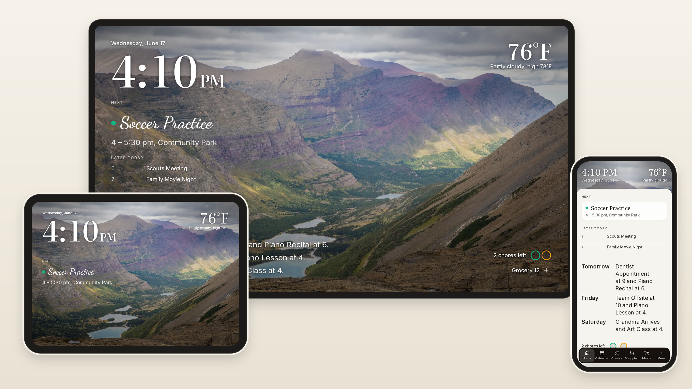
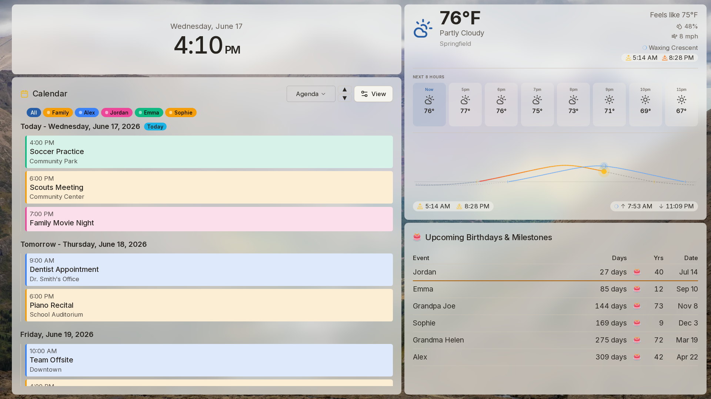
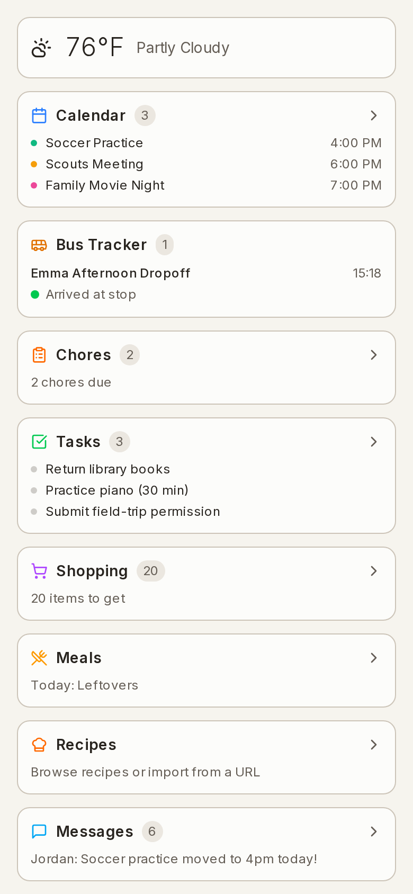

<h1 align="center">Prism</h1>

<p align="center"><b>Your family's day, on the wall.</b><br>
A self-hosted family display for calendars, chores, meals and shopping. No subscription, no account. Your data stays in your house.</p>

<p align="center">
  <a href="https://sandydargoport.github.io/prism/">Website</a> ·
  <a href="https://sandydargoport.github.io/prism/getting-started/install/">Install</a> ·
  <a href="https://sandydargoport.github.io/prism/screenshots/">Screenshots</a> ·
  <a href="https://sandydargoport.github.io/prism/CHANGELOG/">Changelog</a> ·
  <a href="https://github.com/sandydargoport/prism/discussions">Discussions</a>
</p>

<p align="center">
  <a href="https://github.com/sandydargoport/prism/stargazers"></a>
  <a href="https://github.com/sandydargoport/prism/releases"></a>
  <a href="#home-assistant-add-on"></a>
  <a href="https://github.com/sandydargoport/prism/pkgs/container/prism"></a>
  <a href="LICENSE"></a>
</p>

<p align="center"><sub>Wall, tablet and phone · Raspberry Pi 4 or newer · English and German · PIN sign-in, no accounts · one anonymous update check, off with one switch</sub></p>

<p align="center">
  <picture>
    <source media="(prefers-color-scheme: dark)" srcset="docs/demos/hero-dark.png">
    
  </picture>
</p>

## On the wall, and in every pocket

<table>
  <tr>
    <td width="70%" valign="top">
      <picture>
        <source media="(prefers-color-scheme: dark)" srcset="docs/demos/hero-wall-dark.png">
        
      </picture>
    </td>
    <td width="30%" valign="top">
      <picture>
        <source media="(prefers-color-scheme: dark)" srcset="docs/demos/hero-phone-dark.png">
        
      </picture>
    </td>
  </tr>
  <tr>
    <td>A screen in the kitchen shows what is on today, the weather, and who has a birthday coming. When nobody is using it, it becomes a photo frame.</td>
    <td>The same household on everyone's phone, installed as an app.</td>
  </tr>
</table>

## What it replaces

| Instead of | Prism gives you |
|---|---|
| A paid wall-calendar subscription | Google, iCloud and iCal calendars on a screen you already own |
| A chore chart app | Chores and reminders with points that add up to goals |
| A shopping list app | Shared lists grouped by category, a barcode scanner, and a push to your Kroger-family store cart |
| A digital photo frame | Your OneDrive or uploaded photos behind the day, and a photo slideshow when idle |

## Works together

- **Recipe → shopping list → grocery cart.** Add a recipe's ingredients to the list, then send the list to the store in one tap.
- **Chore done → points → goal.** Kids tick chores on the wall, a parent approves, and the points move them toward a reward they chose.
- **Photos → idle screen → travel map.** Photos fill the wall when it is quiet; trips land as pins on a globe.

## Quick start

<details id="home-assistant-add-on">
<summary><b>Home Assistant add-on</b> (no terminal)</summary>

In Home Assistant, go to **Settings → Add-ons → Add-on store**, open the **⋮** menu in the top right, choose **Repositories**, and paste:

```
https://github.com/sandydargoport/prism
```

Find **Prism** in the store, click **Install**, then **Start** on the Info tab. Postgres and Redis run inside the add-on, and everything is kept under Home Assistant's `/data`, so updates and snapshots keep your history. Options and troubleshooting: [`ha-app/README.md`](ha-app/README.md).

</details>

<details>
<summary><b>Pre-built Docker image</b> (any Linux machine, NAS or Raspberry Pi)</summary>

```bash
curl -O https://raw.githubusercontent.com/sandydargoport/prism/master/docker-compose.yml
curl -O https://raw.githubusercontent.com/sandydargoport/prism/master/.env.example
cp .env.example .env
docker compose up -d
```

</details>

<details>
<summary><b>Build it yourself</b></summary>

```bash
git clone https://github.com/sandydargoport/prism.git
cd prism
bash scripts/install.sh
```

</details>

Then open **<http://localhost:3000>** (on Home Assistant, the port 3000 link in the add-on panel). The setup wizard adds your family, a PIN for each person, a calendar, and a look. To look around with a made-up family first, set `PRISM_DEMO_SEED=true` in `.env` before the first start; every demo account uses PIN `1234`.

HTTPS, Raspberry Pi notes and troubleshooting: the [install guide](https://sandydargoport.github.io/prism/getting-started/install/).

## Before you install

- **What does it cost?** Nothing. There is no paid tier and no account to make.
- **What is the licence?** Free for personal and non-commercial use ([PolyForm Noncommercial 1.0.0](LICENSE)). You can run it, change it and share it; you cannot sell it or run it as a paid service.
- **Where does the data live?** On your own machine, in a Postgres database next to the app. Settings → Backup exports it.
- **What does it contact?** Only the services you switch on (calendars, photos, weather, grocery), plus one anonymous weekly update check you can turn off. [What it sends](https://sandydargoport.github.io/prism/features/TELEMETRY/).
- **What if the project stops?** Your install keeps working. It does not depend on any server of ours.
- **What screen do I need?** Anything with a web browser: a wall-mounted TV or monitor, a tablet, or a phone.

## Documentation

- **[Get started](https://sandydargoport.github.io/prism/getting-started/install/)**: install, first-time setup, updating
- **[User guide](https://sandydargoport.github.io/prism/HELP/)**: calendar, chores, shopping, recipes, photos, the phone app
- **[Integrations](https://sandydargoport.github.io/prism/home-assistant/)**: Home Assistant, iCloud, Kroger, the voice API
- **[Changelog](https://sandydargoport.github.io/prism/CHANGELOG/)**: every release

## Behind the project

Prism started as one family's wall display that connects to the tools they already use, without a monthly fee.

## Contributing

Bug reports, ideas and pull requests are welcome. Start with [CONTRIBUTING.md](CONTRIBUTING.md); ideas and questions go to [Discussions](https://github.com/sandydargoport/prism/discussions). Security issues: [SECURITY.md](SECURITY.md).

<sub>[](https://github.com/sandydargoport/prism/actions/workflows/test-install.yml)</sub>

## Acknowledgments

Built with Claude Code.
