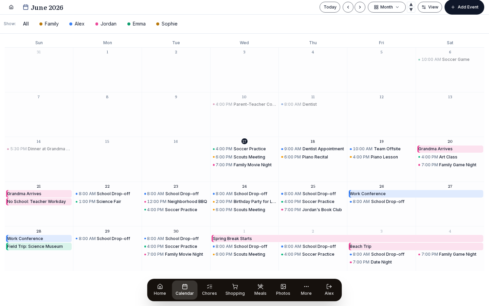

# Calendar

See everyone's events in one calendar, each person in their own colour. Connect Google, iCloud or any calendar link.

{ .hero-image }

Meals, chores and to-dos show up next to the events. Google calendars sync both ways, and calendar links are read-only. You get seven views, you can drag an event to a new day, and Prism keeps syncing when nobody is looking at the screen.

## Set it up

### Setting up calendar sources

#### Personal & Family calendars (no integration needed)

You can start using the calendar without connecting anything. A fresh install gives every family member their own personal calendar, plus one shared **Family** calendar for household events, and you can add events to any of them straight away. The accounts you connect below add more sources on top of these.

#### Google Calendar (OAuth, bidirectional)

*Settings → Integrations → Google → Connect.*

OAuth (Google's sign-in and permission flow) gives Prism read and write access to your Google calendars. You can create, edit, drag and delete events in Prism, and the change reaches Google Calendar within seconds. Every calendar in the Google account (personal, family-shared, work and so on) is listed in the **Manage** overlay on the Calendar page, where you pick which ones to show.

This connection covers Calendar only. Google Tasks sync is set per list inside the Google provider card on the same *Settings → Integrations* page.

#### Google Calendar without a public URL (OAuth Playground)

*Settings → Integrations → Google → **Connect without a public URL (advanced)**.*

The normal **Connect** button needs a public HTTPS address, because Google will not register a private or LAN redirect URI such as `http://homeassistant.local:8123/…` or `http://192.168.x.x:3000/…`. If you try, you see *"must end with a public top-level domain."* When Prism only runs on your LAN (Home Assistant add-on, bare Docker) and you don't want to put it behind a public URL, you can still get full read and write access. You make a refresh token yourself in Google's OAuth Playground and paste it into Prism. The sign-in happens on Google's own domain and never passes through a third party.

Do every step signed into one Google account, the one whose calendars you want, and use a private or incognito window so the accounts can't get mixed up. Most setup trouble here comes from having the project under one account and the calendars under another.

1. In the [Google Cloud Console](https://console.cloud.google.com/), **create a project**, then enable the **Google Calendar API**.
2. Configure the **OAuth consent screen**: pick User type **External** and fill in the app name and your support and developer email.
3. **Publish the app to Production.** Don't skip this one. In *Testing* mode Google expires refresh tokens after 7 days, and publishing removes that limit. You own the project, so you can click through the one-time "Google hasn't verified this app" notice (**Advanced → proceed**). Your own use of the Calendar scope needs no formal verification.
4. Create an **OAuth Client ID** of type **Web application**. Under **Authorized redirect URIs**, add exactly `https://developers.google.com/oauthplayground`. Copy the **Client ID** and **Client Secret**. Google shows the secret only once.
5. Open the [OAuth 2.0 Playground](https://developers.google.com/oauthplayground), click the gear icon, tick **"Use your own OAuth credentials"** and paste in the Client ID and Secret.
6. In *Step 1*, enter the scope `https://www.googleapis.com/auth/calendar`, click **Authorize APIs**, sign in, then **Advanced → proceed → Allow**.
7. In *Step 2*, click **Exchange authorization code for tokens** and copy the **Refresh token** (it starts with `1//`).
8. In Prism, open **Settings → Integrations → Google → "Connect without a public URL (advanced)"** and paste the Client ID, Client Secret and Refresh token. Prism checks them with Google and imports your calendars with full read and write access.

**Troubleshooting:**

- *"Google rejected the client ID / secret pair"* means the Client ID and Secret don't match, or the secret was rotated. Open your client in the Console, generate a new secret (shown only once) and use it in both the Playground and Prism.
- *"Google rejected the refresh token"* means the token expired, was revoked, or was made with a different client from the one you pasted. Make a new token in the Playground with the same Client ID and Secret, in one go, and paste it right away. Check that you copied the **Refresh token** (`1//…`) and left the Access token (`ya29.…`) alone.
- If the Playground's *Exchange* step returns no refresh token, you have already granted the app once. Revoke it at [myaccount.google.com/permissions](https://myaccount.google.com/permissions), then authorize again to get a fresh consent.
- If the project doesn't appear in the Console, you are signed into the wrong Google account. The project, client, consent screen and Playground authorization all have to be on the same account.

To take away Prism's access completely, go to *Google Account → Security → Third-party access*.

#### iCal subscriptions (read-only)

*Open the Calendar page → **Manage** → Subscribe to a calendar → paste URL.*

Many calendars are published as an `.ics` URL: school calendars, sports leagues, holiday feeds, a spouse's outlook.live.com calendar. Paste the URL and Prism subscribes to it. The events sync every so often and appear with your Google events. These feeds have no way to accept changes, so iCal sources are always read-only. Their events display like any others, but Prism offers no edit controls for them.

#### Apple Calendar / iCloud (read-only via the iCal feed)

iCloud has no OAuth sign-in and no public REST API, so Prism uses the same iCal subscription here. Apple gives you a `webcal://` URL for any calendar you mark as Public. On a Mac:

1. Open *Calendar.app*, right-click the calendar in the sidebar and choose *Share Calendar*.
2. Tick **Public Calendar**, and a URL appears underneath.
3. Click the *share* button next to the URL and choose *Copy Link*. The link starts with `webcal://`.
4. In Prism, open the Calendar page → **Manage** → *Subscribe to a calendar*, paste the URL, give it a name and click *Add*.

On iCloud.com it works the same way: *Calendar → ⓘ next to the calendar → Public Calendar → Copy Link*.

Two things to know. The feed only goes one way, so nothing you do in Prism reaches iCloud, and Prism shows no edit option on these events. The calendar also has to stay marked Public on the iCloud side.

#### Apple iCloud (CalDAV, private calendars + Reminders), *alpha*

If you don't want to mark a calendar Public, or you want **Reminders** to sync as tasks, Prism can connect to iCloud over CalDAV. That is the same protocol the Calendar app on macOS and iOS uses.

1. Generate an app-specific password at [appleid.apple.com](https://appleid.apple.com) under *Sign-In and Security → App-Specific Passwords → Generate*.
2. In Prism, go to *Settings → Integrations → Apple iCloud / CalDAV → Connect*.
3. Enter:
   - **Server URL:** `https://caldav.icloud.com`
   - **Username:** your iCloud email
   - **Password:** the app-specific password from step 1 (your Apple ID password will not work)
4. Click *Test Connection*, then *Find Calendars*, choose the calendars and Reminders lists to sync, and click *Connect*.

The same steps work for **Nextcloud** (`https://your-server/remote.php/dav`), **Radicale**, **Baikal** (`https://your-server/dav.php`) and **Synology Calendar** (`https://your-nas:5001/caldav/`).

Editing a CalDAV event in Prism changes it on the server as well. Prism reads the event, changes only the fields you edited and writes it back, so alarms, invitees, the repeat rule and other apps' properties survive. On a repeating event, a new title, notes or place apply to the whole series. A new time for one occurrence stays in Prism only, with a warning, and the next sync puts the old time back. If someone changed the event elsewhere while you were saving, Prism refuses the save so it doesn't overwrite their change. On a read-only calendar the edit stays in Prism with a warning.

A new event you create in Prism on a CalDAV calendar is created on the server too, repeating ones included. Prism writes repeating events in the household time zone so they keep their time of day across clock changes. Deleting a single, non-repeating synced event in Prism also deletes it from the source server (iCloud, Nextcloud and the rest), so treat that delete as permanent. Deleting a repeating series still only removes it from Prism. App-specific passwords are stored encrypted in the Prism database and never leave your server. Apple Reminders lists that are still on CalDAV sync into Prism's Tasks list, one way, with the same priorities and due dates the iOS app uses. Apple has moved most lists to a newer system with no outside access, and those do not come through.

> Wondering what *else* you can pull from iCloud (Reminders, Notes, Photos, Find My)? See the [iCloud integration overview](ICLOUD.md). The short answer is that calendars and contacts work, Reminders work only for lists Apple has not moved to its newer system, and nothing else does, for a structural reason that page explains.

#### Per-calendar customization

In the **Manage** overlay on the Calendar page, each source has these settings:

- **Enable/disable**: turn a calendar off without disconnecting it. A disabled calendar doesn't appear anywhere in Prism.
- **Assign to a family member**: link the calendar to a person so its events go in that person's column in Day and List views. Mark a shared household calendar as **Family**.
- **Display name**: replace the Google or iCal name (for example "Mike's Work" becomes "Work").
- **Color**: replace the source's default color.
- **Show in Add Event modal**: untick this for subscription and read-only calendars so they aren't offered when you create an event.

### Calendar Groups & Columns

In Day and List views, events sit in columns, one per calendar group:

- The **Family** group always comes first and holds shared or Family-tagged calendars.
- Person columns follow, in the order set in *Settings → Family Members*. Reorder the family members there to change the columns.
- The **Merge / Split** toggle in View Options puts every event in one column or splits them by person.

The filter buttons at the top of the calendar show or hide calendar groups in the current view. Click **All** to show everything again.

### Hidden Hours

You can hide a range of hours from the Day, Schedule and Week views so the space goes to the hours your family uses. Set the range in the **Manage** overlay on the Calendar page, under Calendar Hours, with a start hour (say midnight) and an end hour (say 6 AM).

The **clock button** in the calendar views turns hiding on and off, and it dims while hiding is on. The hours that are left stretch to fill the panel, so events don't shrink into tiny blocks.

### Color coding

An event takes its color from the calendar it belongs to. When calendars are assigned to family members, each person's events appear in their column in that calendar's color. You can change the color per calendar in the **Manage** overlay on the Calendar page.

Meals on the calendar have a small **utensils icon** before the title so you can tell them from ordinary events at a glance.

When the same event is on two calendars (say your personal Google calendar and the Family Google calendar), Prism removes the copy by `groupId` when it draws the calendar, so you don't see it twice across columns.

## Use it

### Views

The calendar subpage and the dashboard widget offer the same seven views, except that the widget has no 3 Months:

| View | Best for |
|---|---|
| **Agenda** | A list of upcoming events. This is the default on mobile. |
| **Day** | An hour-by-hour day with calendar columns side by side. |
| **List** | Each day is a row of its events. A wide screen shows this week and next side by side; days with nothing on them fold into one line. With the notes column on, it is one week with a row per day. |
| **Schedule** | The week as one tall column. Good for narrow displays. |
| **2W** | Two weeks as a grid of days. |
| **Month** | The usual calendar grid, drawn over six weeks. |
| **3 Months** | Three months side by side, for planning far ahead. |

The view dropdown has ▲▼ triangles that step through the views in one click. In 2W, next and previous move two weeks at a time.

The 1W, 3W and 4W grids have been removed. A screen that was showing one of them now opens on Schedule (for 1W) or Month (for 3W and 4W).

On phones the calendar only shows Agenda, with no view switcher and no chevrons, and the header reads "Upcoming Events."

Multi-day events, such as trips and holidays, draw as one continuous bar across their days in the Month, multi-week and week grids, instead of a separate chip on each day. Where the bar crosses a week or month boundary it ends in a chevron and carries on in the next row. Events that have already finished are dimmed. All-day events are placed by calendar date, so they stay on the right day whatever time zone the display uses.

### Display modes: inline vs cards

The **View Options** gear next to the view dropdown switches between two layouts for the events in each day cell:

- **Inline**: compact rows of event titles. This is the original look and fits the most events in a cell.
- **Cards**: each day becomes a small card. Events fill the top, and the day's chores, tasks and meals sit in a separate band at the bottom (meals last), so the schedule and the day's plan read as two zones. Prism measures how much fits based on your text size and screen size, and anything that doesn't fit goes into a "+N more" popover so nothing is cut off without you knowing.

You need cards mode for drag-and-drop and for overlays.

The calendar subpage and the dashboard CalendarWidget each remember their own display mode.

### Drag-and-drop

In **cards mode** you can drag any of these from one day to another:

- Events
- Meals
- Chores
- Tasks

Dragging works in Day, List, Schedule, 2W, Month, 3 Months and Agenda, and on the dashboard CalendarWidget as well. A drag starts after the pointer moves 5px, so a single tap still opens the card for editing.

If the API refuses the move (moving one occurrence of a recurring event can be restricted, for example), the error appears as a `moveError` chip on the cell you dragged from, so a failed move is always visible.

#### What gets preserved when you drag

- **Tasks** keep their time of day. A 9am task dragged from Tuesday to Thursday is still at 9am and doesn't jump to 23:59.
- **Events** keep their start and end times, and only the date changes.
- **Meals and chores** usually have no set time, so they simply move to the new day.

### Click-to-edit from the widget

You can click the tasks, chores and meals on the dashboard CalendarWidget. A tap opens the same edit modal the calendar subpage uses. The modals load only when needed, so they don't slow down the dashboard's first paint.

That means most calendar jobs can be done from the dashboard: edit a chore, drag a meal or open an event's details, all without going to `/calendar`.

### View Options menu

The gear next to the view dropdown opens View Options. Which toggles you see depends on the view:

- **Hide weekends**: multi-week views only, since those are the only views where hiding weekends makes sense.
- **Merge calendars**: puts all events in one column in Day and List views instead of one column per person.
- **Show notes column**: Day and Schedule views only. Shows the calendar notes panel beside the events.
- **Overlay toggles**: show or hide events, meals, chores and tasks separately. A badge on the View Options button tells you when any of these is changed from its default.
- **Display mode**: Inline or Cards. You can set it here too, on top of the per-view default.
- **Reset to defaults**: puts every option back.

These settings are saved in the browser's localStorage, separately for the subpage and the dashboard widget.

### Calendar Notes

Click the **sticky note icon** in the calendar header to open a notes panel beside the Day or List view. Each note belongs to one calendar date. The whole family shares the same notes, and there are no per-person notes. A note saves itself after 2 seconds without typing and when you click away, and it supports light Markdown through keyboard shortcuts.

While you are typing in a note:

- **Ctrl+B** Bold
- **Ctrl+I** Italic
- **Ctrl+U** Underline
- **Ctrl+Shift+S** Strikethrough
- **Ctrl+Shift+L** Bullet list (typing `- ` at the start of a line does the same)

When nobody is logged in, notes are read-only, so the screensaver and babysitter view can show them without letting anyone edit them.

### Hiding an event

A parent can hide an event without deleting it. Click the event and tick **Hide in Prism**. It disappears straight away from every view, widget and voice answer, and a toast offers **Undo**. The event stays in its source calendar, and later syncs don't bring it back.

On one occurrence of a recurring event from Google or an iCal feed, ticking the box asks whether you mean **This event** or **Every event in the series**. Hiding the series also hides occurrences that sync in later. Events from a CalDAV calendar can only be hidden one at a time for now.

Hidden events and series are listed under **Hidden events** in the **Manage** overlay on the Calendar page (Settings → Calendars), and **Unhide** brings one back.

Hiding is separate from **Delete**. Delete removes the event from Prism and, for Google events and single CalDAV events, from the source calendar as well.

### Adding events

Click **Add Event** in the calendar header or on the CalendarWidget. The modal has these fields:

- **Title** (required)
- **Calendar**: the Prism, Google and CalDAV calendars marked "Show in Add Event modal" (*Settings → Calendars*). iCal feeds aren't offered, and neither are calendars with subscription-style names (Birthdays, Holidays, Week Numbers).
- **Color**: a preset palette plus your profile color.
- **Description**
- **Location**
- **Start / End time**, or the **All day** toggle.
- **Recurrence**: None, Daily, Every weekday, Weekly, Monthly, Yearly, or **Custom…**. Custom lets you repeat every N days, weeks, months or years; on chosen days of the week; monthly or yearly on the date or on the nth weekday ("the third Wednesday"); and end never, on a date or after N times. A weekly repeat starts on the first chosen day on or after the start date. If a rule from another app can't be shown in the builder, Prism keeps it as it is. Opening any occurrence of a repeating event made in Prism edits the whole series.

Subscription and read-only calendars are left out of the picker automatically.

### Mobile behavior

- On a phone the calendar shows only the **Agenda view**: a list of upcoming events that you can swipe to dismiss.
- The view switcher is hidden.
- The header just says "Upcoming Events."
- Swipe left or right to move between periods.

This is on purpose. The grid views don't fit well on a phone, and when you check the calendar on the go you mostly want the list of what's next.

## Details

### Server-side sync

A background job runs every 10 minutes and keeps Google and iCal events in sync, so nobody needs to have the dashboard open. By default it syncs from 90 days back to 365 days ahead. That keeps the last three months filled in for looking back, and leaves room for the next school year.

Events outside that window are never deleted. Once an event is in Prism's database it stays there. The pass that deletes removed events only looks inside the window, so making the window smaller by hand won't lose your history.

#### Review before deleting

Sync never removes events without asking. When an event disappears from its source, Prism holds the removal and shows a **Review N** badge on the calendar. Open it and choose for each event: **Keep** leaves it in Prism, **Delete** removes it. You need delete permission to apply a deletion. New and changed events from the source still come in automatically, and only removals wait for you.

#### When sync stops

A connection can expire or be revoked. A password change can do it, so can withdrawing the grant on the provider's own security page, and so can an OAuth consent screen still in Testing, which limits tokens to seven days. When that happens sync stops, and a calendar that has stopped syncing looks just like a calendar with nothing on it.

Prism tells you when this happens. A **Sync paused** badge appears on the Calendar page next to **Review N**, and a matching line appears on the Calendar dashboard widget. Either one opens the **Manage** overlay, where the **Reconnect** button restores the connection for every calendar on that account at once.

The badge says as little as possible: how many calendars are affected, and which service if they are all on the same one. It never names a calendar or an account, because anyone walking past can read a wall display. It also stays off the screensaver.

Set `PRISM_DISABLE_CALENDAR_CRON=true` in your `.env` if you only want syncs you start yourself, for example on a low-power device where you don't want background work. You can always sync by hand from the **Manage** overlay on the Calendar page (*Sync*).

### Troubleshooting

#### Events not showing

1. Open the Calendar page → **Manage** and check that the calendar is enabled.
2. Tap **Sync** to force a refresh.
3. Check *Settings → Integrations* to see if Google is still connected. OAuth tokens stop working if they are revoked on the Google side.
4. The background sync also runs every 10 minutes, so you can wait one round.
5. Look in **Hidden events** in the **Manage** overlay. A hidden event stays hidden through every sync.

#### Events appearing in the wrong person's column

Check which person the calendar is assigned to in the **Manage** overlay on the Calendar page. An event that is on both a personal calendar and the Family calendar is shown once, matched by `groupId`. If you still see duplicates, file an issue and include the calendar names.

#### "Sync paused" badge won't clear

Reconnecting clears the flag as soon as Google sends you back to Prism, but only for the calendars that account can see. If you sync calendars from two Google accounts and reconnect one, the other stays flagged and the badge stays up with a smaller count. Reconnect each account.

If the badge clears and then comes back within a week, the grant is being revoked each time. Check whether the Google Cloud project's OAuth consent screen is still in **Testing** status, which limits refresh tokens to seven days however often you use them. Publishing the consent screen removes that limit.

#### Sync cron not running

Check whether `PRISM_DISABLE_CALENDAR_CRON` is set to `true` in `.env`, since that turns the job off. If it isn't, the job starts from `instrumentation.ts` when the app starts and runs every 10 minutes.

#### Drag-and-drop not working

Drag-and-drop only works in **cards display mode**, which you can switch to from the View Options gear. Move the pointer about 5px while holding a chore, meal or task before you drag; a quick click opens the edit modal instead.

#### "Failed to move" error chip

The API refused the move. The usual cause is dragging one occurrence of a recurring event to another day, which Google Calendar's API restricts. Move the original event, or detach the occurrence first.

#### Hidden hours showing the wrong range

The hours use the 24-hour clock, so midnight to 6am is `0` to `6`. Check Calendar Hours in the **Manage** overlay on the Calendar page and save again if needed.

#### Forecast day-of-week labels are off

Older versions had a time zone bug: for people west of UTC, an event that crossed midnight UTC showed on the wrong day. It was fixed in v1.7. If you still see it, hard-reload the PWA to clear old cached files.
