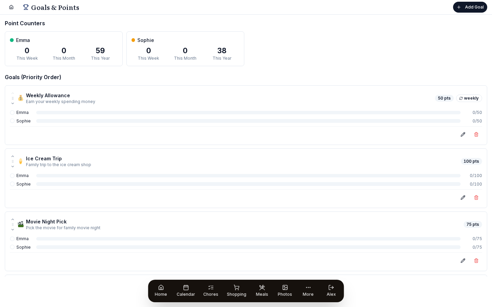

# Points and rewards

Kids earn points for chores and spend them on rewards they chose.

{ .hero-image }

A parent sets each reward (a toy, a treat, a privilege) and how many points it costs. Points fill the rewards in the order you choose, and the screen celebrates when one is reached.

## Set it up

### Goals

A goal is something a kid works toward by collecting points. The sample data comes with these:

- **Weekly Allowance**: 50 pts, recurring weekly. It resets every Sunday.
- **Ice Cream Trip**: 100 pts, one-time. Points build up across weeks.
- **Movie Night Pick**: 75 pts, one-time.
- **New LEGO Set**: 300 pts, one-time. This one takes a good while to reach.
- **Sleepover**: 200 pts, one-time.

#### Per-goal config

- **Name** (required)
- **Description**
- **Emoji**: picked from a fixed set of icons (🎯 🍦 🎬 🎮 📱 🎁 🏖️ 🎪 ⭐ 💰 🍕 🎵).
- **Point cost**
- **Priority**: a whole number, where 1 is the highest. It decides the fill order (see [The waterfall](#the-waterfall)).
- **Recurring**: yes or no.
- **Recurrence period**: `weekly`, `monthly` or `yearly`, for a recurring goal.

#### One-time vs. Recurring

- **One-time**: points keep adding up until the goal is reached. When a parent resets a reached goal, its progress starts again at 0. A parent can also delete it.
- **Recurring**: only points from the current period count. When the period ends (Sunday midnight for a weekly goal), any unspent points expire and the kid earns them again next period. This suits a steady reward like an allowance.

### Permissions

| Action | Parent | Child |
|---|---|---|
| View goals + progress | Yes | Yes |
| Create / edit / delete goals | Yes | No |
| Reorder priority | Yes | No |
| Reset an achieved goal | Yes | No |
| See pending-approval queue | Yes | Own only |

## Use it

### How points work

#### Earning

Points come from chores once they are approved:

1. A parent creates a chore with a `pointValue` (any whole number from 0 up).
2. A child marks the chore done.
3. If the chore has **Requires approval** turned on (new chores do), the completion waits as "Pending approval" and no points are given yet. It waits for a parent whether the child marked it in the app or by voice. A chore without approval is approved the moment the child marks it, with no waiting for step 4.
4. A parent approves it, and the points go onto the child's totals.
5. When a parent marks a chore done (for themselves, or on a child's behalf), it is approved at once with no separate approval step. By voice, a chore with `requiresApproval` always waits for approval in the app, because Prism cannot tell who is speaking.

Each completion stores the points it earned (the `pointsAwarded` column on `chore_completions`), copied from the chore's `pointValue` at the moment it was done. To change what a chore is worth, edit its point value in the chore editor.

#### Counters

Each child has running totals over four periods:

- **This week**: Sunday to Saturday, or Monday to Sunday, following *Settings → General → Week Starts On*.
- **This month**: the calendar month.
- **This year**: the calendar year.
- **All time**: since chore tracking began.

Points waiting for approval (chores marked done but not yet approved) are shown apart from these totals, so kids can see what is on the way.

### Goals page

#### Per-child sections

Each child has a section with:

- Their avatar, name and color.
- **Point counters**: This Week, This Month and This Year totals.
- **Goal progress cards**: one for each active goal, with a progress bar.

Click a goal card to see its details, and, for parents, the controls.

#### Goal cards

Each card shows:

- The emoji and goal name.
- The point cost.
- A progress bar for the child's progress toward the goal.
- A **Recurring** badge with the period, on recurring goals.
- An **Achieved!** checkmark once the bar is full.

Reaching a goal plays a celebration (see [Celebrations](#celebrations)).

#### Parent controls

Parents get extra controls on each goal:

- **Edit**: change any field.
- **Delete**: remove the goal.
- **Reorder priority**: the ▲▼ buttons, or drag.
- **Reset**: a button on reached one-time goals. It clears the goal's reached state and progress and starts it again from 0.

Children can see goals and progress, but cannot create, edit or reset them.

### Celebrations

When a child's progress on a goal reaches 100%, an animation plays. The scene changes with the season, depending on which week of the year it is:

| Window | Animation |
|---|---|
| Valentine's week | Hearts |
| St. Patrick's week | Leprechaun + gold |
| Easter week | Easter bunny + eggs |
| Mother's Day week | Spring flowers |
| Memorial Day week | Flags + stars |
| July 4th week | Bald eagle + fireworks |
| Halloween week | Jack-o-lantern + bats |
| Thanksgiving week | Cornucopia |
| Christmas week | Santa's gift bag |
| New Year's week | Fireworks + confetti |
| All other times | Trophy + confetti |

If the device asks for reduced motion (`prefers-reduced-motion`) or Prism's performance level is Reduced or Minimal, the animation is skipped. The completion event still fires, so the celebration count still goes up.

### Dashboard widgets

#### PointsWidget

A small summary on the dashboard. For each child it shows their name and color, the points they earned this week, a progress bar for their top-priority goal, and a checkmark on any goal they have reached. The widget loads only when it is needed (lazy-loaded).

It is sized for a corner of a 4-column grid, 3×5 cells to start with.

#### ChoresWidget

This is a chores widget, but it is also where parents see points waiting for approval. Chores waiting for approval sit at the top of the widget for parents, and tapping one approves it and gives the points straight away.

### Resetting an achieved goal

When a one-time goal is reached, a parent can reset it to start again:

1. Tap the **Reset** button on the reached goal.
2. Prism deletes the goal's `goal_achievements` rows and updates its `lastResetAt`, so progress starts again at 0.

Reset clears the reached state and progress for the whole goal, for every child who was working toward it. It does not ask for a PIN and is not written to the activity log.

Reset is for the moment you hand over the reward and start fresh. Prism keeps the score and leaves the handing over to you.

Recurring goals such as an allowance have no reset. Their points roll over when the period ends.

### Common workflows

#### Allowance + occasional treats

- Make "Weekly Allowance" a recurring weekly goal at priority 1, costing 50.
- Add 2 or 3 one-time goals (Ice Cream Trip, Movie Night, LEGO Set) at lower priorities.
- The allowance always fills first, and anything left over goes into the bigger goals.

#### Saving for a big-ticket item

- Make "Bike Helmet Upgrade" a one-time goal of 500 pts at priority 1.
- Every point earned goes there until it is full, and the kids watch the bar climb week by week.
- Once it is reached and reset, lower its priority or delete it.

#### Behavior incentive

- Add a quick-win goal with a low cost (25 pts, "Pick the dinner") at a high priority.
- Have it reset weekly, and a kid who does their chores will earn it nearly every week.

## Details

### The waterfall

When a child earns points, they fill goals one at a time in priority order, and are not shared out evenly. The steps are:

1. Sort the child's active goals by priority, 1 first.
2. For each goal:
   - Work out `available_for_this_goal = min(points_remaining, goal.pointCost - current_progress)`.
   - Add that to the goal's progress.
   - Take it off `points_remaining`.
   - For a recurring goal, count only points from the current period toward its target.
3. Stop when `points_remaining = 0`.

So if Emma has 50 points and her Weekly Allowance (50 pts, priority 1) is not full, every point goes there first. Once the allowance is full, the rest carries on down the list to Ice Cream Trip, Movie Night and so on.

To change which goal fills first, change the priority order with the ▲▼ arrows next to each goal on the Goals page (*Goals page → priority arrows ▲▼*).

### Cache invalidation

Prism caches results to answer faster, and has to clear (invalidate) the cache when the data changes. Chores, points and goals depend on each other more than anything else in Prism:

- Creating, editing or deleting a chore clears `chores:*`, which in turn clears `points:*` and `goals:*`.
- Approving a chore clears the same chain.
- Creating, editing or deleting a goal clears `goals:*` and `points:*`.
- Resetting a goal clears `goals:*` and `points:*`.

If point totals look out of date after you approve a chore, tap Sync on the dashboard or check the Redis cache. This part was rewritten three times before it settled on the shared `invalidateEntity()` helper, which now handles it correctly.

### Troubleshooting

#### "I approved a chore but points didn't update"

Hard-reload the dashboard. The cache should clear by itself, but a tab left open for a long time can miss the refresh. Check the audit log to confirm the approval was recorded.

#### Recurring goal didn't reset on Sunday

The reset happens at midnight local time at the start of the week you have set. If *Week Starts On* is Monday, weekly recurring goals reset on Mondays.

#### Two kids have the same goal: point totals are wrong

There is one row per goal for the whole family, but each child's progress is tracked separately in the `goal_achievements` table, so two children on the same goal never share progress. If the totals look wrong, check `completedBy` on the chore completion. That field decides which child gets the points.

#### Celebration animation didn't fire

Check the device's reduced-motion setting (`prefers-reduced-motion`, under System Settings → Accessibility) and Prism's performance level (*Settings → Appearance → Performance*). Reduced motion on the device, or a Reduced or Minimal level in Prism, stops the animation, but the goal is still recorded as reached.
