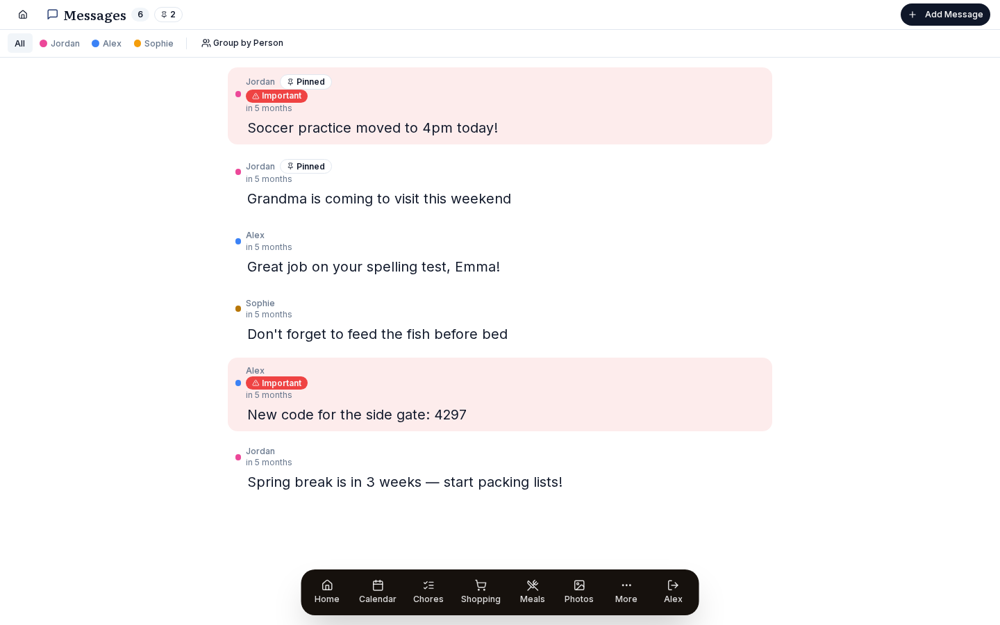

# Messages

Leave a note for the family on the wall. Everyone sees it when they walk past, and nobody gets a notification.

{ .hero-image }

## Use it

### Posting

You can post a message from two places:

1. **From the dashboard MessagesWidget**: the **+** (Add message) button opens the Post Message window.
2. **From the full Messages page**: go to *nav → Messages* and type in the box at the top.

Both need you to be logged in. The message is signed with whoever is logged in, so nobody can post as someone else.

#### Notes from the babysitter

While Babysitter Mode is on, the babysitter can leave a note without logging in, from the Babysitter Mode screen or the `/babysitter` page. It shows on the board from **Babysitter**, or **Babysitter (Sam)** if they gave a name, with a 🍼 avatar. See [Display Modes](DISPLAY-MODES.md#leaving-a-note-for-the-family).

### Expiration

When you post, you can pick how long the message lasts:

- **No expiration** (the default)
- **12 hours**
- **1 day**
- **2 days**
- **3 days**
- **7 days**

This suits short-lived notes: "Pizza in the fridge from tonight" for 12 hours, "Snow day: no school" for a day, "Hosting brunch Sunday, RSVP by Friday" for 3 days.

Once a message's time is up it disappears from every view, because the server leaves expired messages out when it reads them. The messages stay in the database, and nothing clears them out later.

### Pinning

You pin a message **when you post it**, with the **Pin to top** checkbox in the Post Message window. You cannot pin or unpin a message from the list yet, so to change it you post the message again. A pinned message:

- Sorts to the top of the list, above everything else however old it is.
- Has a pin icon and a light background tint.

Pin the notes that work like house rules ("WiFi: TacosForever42", "Gate code: 4297").

### Important flag

Mark a message **important** to make it stand out. It gets a red icon and accent beside it and a slightly darker background, so it reads as "please look at this."

Pinned and important are separate. A message can be pinned and important, only one of the two, or neither.

### Editing

Hover over a message, or tap it on a phone, to show the **pencil icon**. Click it to edit the message where it is:

- The text turns into a box you can type in.
- **Ctrl+Enter** saves.
- **Escape** cancels.
- The author and posting time stay the same, and `updated_at` changes to now.

Everyone can edit their own messages, and parents can edit any message.

### Deleting

Each message has a trash icon, which shows when you hover over it or press and hold:

- **Authors** can delete their own messages.
- **Parents** can delete any message.
- Children cannot delete anyone else's messages.
- Only a parent can edit or delete a note from the babysitter.

Before the message goes, a window asks "Delete this message?" and warns "This action cannot be undone." Deleting is permanent and there is no undo.

### Group by person

The Messages page has a **Group by Person** switch:

- **Off**: one list in time order, newest first, with pinned messages at the top.
- **On**: a card in each family member's color, holding that person's recent messages.

Grouping helps when there are a lot of messages and you want to see what Jordan has posted lately.

### Dashboard MessagesWidget

The widget shows the latest few messages, each with:

- The author's avatar and name, in their color.
- The message text, cut short if it is very long. Tap it to read the rest.
- Pinned and important badges where they apply.

It also has a **+** (Add message) button that opens the Post Message window. You cannot type a message straight into the widget.

It is sized for a corner of the dashboard.

### Use cases

#### Standing house info

Pin the things everyone should always be able to find:

- The WiFi password.
- Door and gate codes.
- Which day the trash and recycling go out.
- House rules.
- "If something breaks, the breaker box is in the garage."

Together the pinned messages work as a small house wiki.

#### Time-sensitive announcements

Set a message to expire after a day for things that matter today and not tomorrow:

- "Pizza in fridge from tonight."
- "Don't use the upstairs shower. Fixing it Wednesday."
- "Mom's at the dentist 'til 3."

#### Encouragement / "great job"

A quick "Great job on your spelling test, Emma! 🌟" shows up where the whole family will see it, with no phone notification.

#### Coordination between parents

Sometimes you and your partner need a shared note that will last longer than a text. Post "Grandma is coming Sunday" as a message and you will both see it the next time you walk past the dashboard. You can pin it until she has left.

## Details

### What a message has

- **Message text**: up to 500 characters. A counter shows how many are left while you post or edit.
- **Author**: whoever was logged in when it was posted.
- **Pinned**: yes or no. Pinned messages sort to the top however old they are.
- **Important**: yes or no. Important messages get a red accent and icon.
- **Expires at**: an optional time. After it passes, the message is hidden from every view (the server filters it out when reading), and it stays in the database.
- **Created at** / **Updated at**: filled in automatically.

### Privacy

Only logged-in family members can see messages. The babysitter and away-mode views do not show them. While Babysitter Mode is on, a babysitter can add a note but cannot read the board, their own notes included.

Messages are kept in your Prism database and do not sync to Microsoft To Do, Google or anywhere else. That is on purpose: messages are short-lived notes and have no place in a task tracker.

### Troubleshooting

#### Message vanished after a few hours

It most likely had an expiration set. Check the expiration dropdown when you post; it starts on "No expiration."

#### Edit pencil doesn't appear

There are two possible reasons:

- Nobody is logged in. Messages are read-only until someone logs in.
- You are not the author and not a parent. Children cannot edit other people's messages.

#### Message order looks weird

Pinned messages come first, newest first among them, and then the rest, newest first by `created_at`. If you see a different order, you are probably in the grouped view, where each person's card is sorted on its own.

#### Important badge color clashes with theme

The important accent uses your theme's destructive color, which is usually red. It is pure red on the default light theme and a little softer on the dark theme. A custom theme can change it, so check *Settings → Appearance*.
