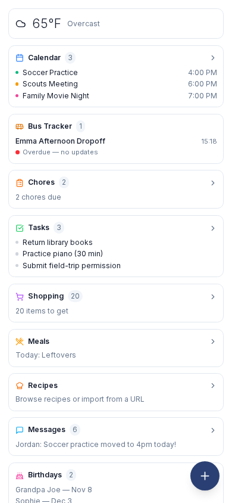

# On your phone

Install Prism on your phone like an app, for lists and the calendar when you are out.

{ .hero-image-mobile width="300" }

The same install works on a phone, a tablet or a wall screen. Prism changes its layout to fit the screen it is on.

## Set it up

### Installation

#### iOS (Safari)

1. Open Prism in Safari.
2. Tap the **Share** button.
3. Select **Add to Home Screen**.
4. Tap **Add**.

The app opens without the browser's own controls, so there is no URL bar or Safari toolbar. It is a standard iOS PWA (a web app installed to the home screen), which supports notification badges, a theme color and a splash screen.

#### Android (Chrome / Edge)

1. Open Prism in Chrome.
2. Tap **Menu** (three dots) → **Install app**, or **Add to Home Screen** on older versions.
3. Confirm.

The app then opens on its own, full screen.

#### Desktop (Chrome / Edge / Brave)

1. Open Prism in the browser.
2. Click the **install icon** in the address bar (the small `+` or computer icon).
3. The app opens in its own window without the browser's controls.

On a computer that only runs the dashboard, you can pin the app to the taskbar and set it to open at startup.

### App icon shortcuts (Android + desktop Chromium)

Long-press the app icon, or right-click it on a desktop, for shortcuts that jump straight to a page:

- **Shopping**
- **Tasks**
- **Messages**

You can add your own shortcuts by editing `public/manifest.json`.

## Use it

### Navigation by surface

Prism has three navigation components and picks one by screen size and orientation:

| Layout | Component | When |
|---|---|---|
| **SideNav** | Collapsible left sidebar | Landscape desktops and large tablets. This is what most kiosks use. |
| **PortraitNav** | Bottom drawer + sliding panel | Portrait tablets. A bar at the bottom has a drawer that slides up for more pages. |
| **MobileNav (FAB)** | Floating action button | Phones. One floating button takes the place of the bottom bar. |

The `AppShell` component chooses the navigation from the current screen size and orientation, and chooses again whenever the orientation changes.

#### FAB (phone PWA)

The Floating Action Button is one round button in the bottom corner. Tap it to open a small menu. The actions in it depend on the page you are on.

On every page:

- **Home**: goes back to the dashboard.
- **Settings**: opens the full Settings page.
- **Login / Logout**: switches users. It shows **Login** when nobody is logged in.

On the dashboard only:

- **Reorder**: drag the dashboard cards into the order you want.
- **Cards**: show or hide dashboard cards, with layout and theme controls too (see below).

On the Shopping page only:

- **Scan Barcode**: scans an item into the active list.

The button takes up as little of the screen as possible and stays out of the way the rest of the time.

#### Card reorder mode

In FAB → Reorder, each dashboard card gets a grip so you can drag it. Drag the cards into order and tap **Done** to save. Each user keeps their own order.

#### FAB → Cards

FAB → Cards has a toggle for each card. Turn off the ones you don't use, for example Bus Tracker if you have no bus to track. Hidden cards aren't drawn at all, which saves the phone some work.

The same panel has two more controls:

- **Layout**: switches the mobile dashboard between **Rows** and **Tiles**.
- **Theme**: steps through **Light / Dark / Auto**.

### Mobile dashboard

On a phone, the dashboard grid turns into a single column of summary cards:

- **Weather card**: the current temperature and conditions, with a small forecast strip.
- **Calendar card**: the next 5 events, as an agenda.
- **Tasks card**: the top 5 unfinished tasks.
- **Shopping card**: the top 5 items on the active list.
- **Chores card**: chores still waiting, for everyone.
- **Meals card**: the meals planned for today.
- **Messages card**: the last 3 messages.
- **Birthdays card**: birthdays coming up.

Those eight show by default. **Clock, Bus Tracker, Recipes, Goals, Wishes, and Photos** are also available, and you can turn them on in FAB → Cards.

Tap a card to open the full page for that feature. You can reorder the cards and hide any of them from the FAB.

### Calendar on mobile

On a phone the calendar only shows the **agenda view**:

- The view switcher is hidden.
- The day and week chevrons are hidden, since they do nothing in the agenda.
- The Today button is hidden.
- The header reads "Upcoming Events" in place of the date.
- A `useEffect` switches to agenda on mobile, whatever view was last picked on a desktop.

The multi-week, month and schedule grids don't fit well on a phone, and when you are out you mostly want the agenda anyway.

### Touch targets + interactions

Every button, list row, checkbox and drag handle is at least **44px** across, the minimum touch target in Apple's guidelines and the size Material Design recommends, so you can hit them without aiming carefully.

The usual gestures:

- **Tap** does the main thing: it ticks off a shopping item, opens a calendar card or opens the page behind a dashboard card.
- **Long-press** gives the other actions (edit, delete, drag). Some lists start a drag on long-press so that swiping up and down still scrolls.
- **Swipe left or right** moves between calendar periods. A swipe has to travel 50px, so a stray sideways movement while scrolling doesn't count.

### Screensaver + Away mode behavior on PWA

An installed PWA does not start the screensaver or Away mode by itself, unless it is a screen named in *Settings → Screens*. Without a name it skips both, for these reasons:

- A phone has no idle time the way a kiosk does. It is either in your pocket or in your hand.
- If Away mode turned on by itself on a phone, it would lock the family member out of their own device.
- A photo slideshow on a phone screen only uses up the battery.

A wall tablet often runs Prism as an installed app so it fills the screen. Name it in *Settings → Screens* and its screensaver and Away mode start on their timers as they do in a browser.

### Common workflows

#### Phone in pocket, occasional checks

Install Prism as a PWA on the phone. It opens on the dashboard summary cards, and a tap on a card opens the full feature. Use the FAB to switch users when you need to.

#### Tablet permanently mounted in the kitchen

Don't install it as a PWA. Open it in full-screen Chrome or use kiosk mode. The SideNav stays visible with nothing held back, so the dashboard grid, Calendar and Shopping are all there. Set the orientation override to match how the tablet is mounted.

#### Phone in shopping mode at the grocery store

Install Prism as a PWA and open the Shopping page. Tap the maximize icon (top right) to enter shopping mode, which fills the screen, hides the navigation and lets you tap items to strike them out. The camera icon in the header scans barcodes.

#### Spouse uses iOS, you use Android

Each of you installs the PWA on your own device. You can have different shopping mode preferences and filter presets while sharing the same data and the same family. With PIN login, switching users on a shared device such as the kitchen tablet takes a tap and that member's PIN (4 or 6 digits).

## Details

### Service worker + offline support

The service worker (`public/sw.js`, a script the browser runs in the background to cache files) stores static files ahead of time:

- The app shell (the `_next` static files: CSS and JS chunks) is cached when the app is installed.
- The start URL (`/`) is fetched from the network first, and the cached copy is used when the device is offline.

That is all it does. It doesn't cache API responses, queue changes made offline or retry them in the background. Prism is built to be used online. If the device goes offline, plan to refresh by hand once you are back online, and expect changes made while offline to be lost.

### Responsive font sizes

The base font size depends on the kind of device:

```css
html { font-size: 16px; }                                        /* phone default */
@media (pointer: fine)                       { font-size: 14px; }  /* desktop mouse */
@media (min-width: 768px)  and (pointer: coarse) { font-size: 18px; }  /* tablet touch */
@media (min-width: 1024px) and (pointer: coarse) { font-size: 20px; }  /* large tablet */
@media (min-width: 1400px) and (pointer: coarse) { font-size: 22px; }  /* kiosk */
```

The `pointer: fine` and `pointer: coarse` media queries tell a mouse (a laptop) apart from touch (a tablet kiosk) at the same screen size. The same 13" screen gets 14px on a laptop with a mouse and 20px on a touch tablet.

A global override in *Settings → Appearance → Font Scale* is planned and had not shipped as of v1.8.

### Orientation detection

The `useOrientation` hook listens for `resize` and `orientationchange` events and returns the current orientation. The `AppShell` picks the navigation again on every orientation change.

You can set an orientation in *Settings → Appearance → Orientation Override* (Landscape, Portrait or Auto). This override only affects which photos and wallpapers are matched by orientation. The navigation and layout keep following the detected orientation of the screen (its width against its height).

### Notification badges (planned)

iOS 16+ and Android Chrome support PWA notification badges, the small number on the app icon. Prism doesn't set a badge count yet. The groundwork is in place, and a follow-up is tracked to show unapproved chores or unread messages there.

### Troubleshooting

#### "Install" prompt missing

To be installable, Prism has to be served over HTTPS with a valid manifest and a valid service worker, and it can't already be installed. If Chrome doesn't offer to install it, look for the install icon (a small `+`) in the address bar, or check DevTools → Application → Manifest for errors.

iOS Safari never shows an install prompt. You always install through Share → Add to Home Screen.

#### Updates not showing after a deploy

The service worker caches heavily. After a deploy, try one of these:

- Force a refresh with a hard reload (Ctrl+Shift+R on a desktop, or pull down and hold in Chrome on mobile).
- Uninstall the PWA and install it again.
- In DevTools → Application → Service Workers, use Update or Unregister.

The service worker is set to take over as soon as a new version arrives, so a reload usually picks up the update within seconds. Now and then a cached page sticks anyway.

#### Bottom nav covers content

Mobile pages have extra space at the bottom to clear the nav bar. If something is hidden behind it, file an issue naming the page. The cause is almost always a missing `pb-20` (or similar) on a page added recently.

#### Calendar showing month view on phone (not agenda)

The agenda-only rule arrived in v1.8. If your phone shows the month view, it is running an older build of the app. Do a hard refresh.

#### FAB missing

The FAB only shows on phone-sized screens (`max-width: 767px`). On a tablet you get the PortraitNav bottom drawer in its place. On a phone the FAB is there whether or not anyone is logged in, and when nobody is, it offers a **Login** action.

#### Cards in mobile dashboard appearing in wrong order

Check whether someone changed the order in FAB → Reorder. Each user keeps their own order, so switching users loads that user's saved order. To set it again, tap FAB → Reorder, drag the cards and tap Done.

#### Service worker registration fails

This is usually a problem with the service worker file's path. Look in DevTools → Console for `Failed to register a ServiceWorker` errors. `public/sw.js` has to be served from the root scope (`/sw.js`). If you moved it, the registration in the app's entry point needs updating too.
