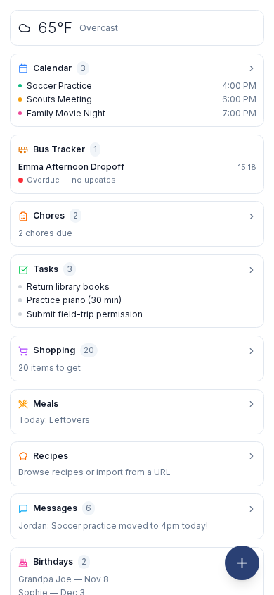

# On your phone

Install Prism on your phone like an app, for lists and the calendar when you are out.

{ .hero-image-mobile width="300" }

The same install works on a phone, a tablet or a wall screen. Prism changes its layout to fit the screen it is on.

## Set it up

### Installation

#### iOS (Safari)

1. Open Prism in Safari.
2. Tap the **Share** button.
3. Select **Add to Home Screen**.
4. Tap **Add**.

The app opens without the browser's own controls, so there is no URL bar or Safari toolbar. It is a standard iOS PWA (a web app installed to the home screen), which supports notification badges, a theme color and a splash screen.

#### Android (Chrome / Edge)

1. Open Prism in Chrome.
2. Tap **Menu** (three dots) > **Install app**, or **Add to Home Screen** on older versions.
3. Confirm.

The app then opens on its own, full screen.

#### Desktop (Chrome / Edge / Brave)

1. Open Prism in the browser.
2. Click the **install icon** in the address bar (the small `+` or computer icon).
3. The app opens in its own window without the browser's controls.

On a computer that only runs the dashboard, you can pin the app to the taskbar and set it to open at startup.

### App icon shortcuts (Android + desktop Chromium)

Long-press the app icon, or right-click it on a desktop, for shortcuts that jump straight to a page:

- **Shopping**
- **Tasks**
- **Messages**

You can add your own shortcuts by editing `public/manifest.json`.

## Use it

### Getting around

Every page has the dock, one row of pages along the bottom of the screen, on a phone as on a wall screen or a laptop. On a phone it holds five pages and **More**: Home, Calendar, Chores, Shopping and Meals, unless the household chose others in *Settings > Features*. Each page shows its icon and its name, and the page you are on is marked. **Home** goes back to the dashboard.

- **More** opens the rest, in four groups: the other pages under **Pages**; **Cards**, **Reorder** and **Reload** under **This phone** (Cards and Reorder only on a dashboard of cards); **Edit a screen**, **Away mode** and **Babysitter mode** under **Screens**; and **Settings**, **Help** and **Sign in** under **Prism**. Signed in, the **Sign in** tile shows your name, and a tap signs you out.
- **More > Edit a screen** is how a phone gets to the editor. A phone is not a screen, so from a phone you edit a screen, never the phone. It asks for a parent's PIN, then opens a screen's editor: with one named screen, that screen; with two or more, *Settings > Screens* to pick one; with none, the default dashboard. The editor shows the screen at its own size, and under its title one line says what you are editing, for example "You are editing Hallway, not this phone." A signed-in child has no **Edit a screen**.
- **Swipe in from the edge** to move along the dock: from the left edge of the screen to the page before, from the right edge to the next one. The swipe has to start at the very edge and go sideways, so a swipe in the middle of a page (the Calendar's dates, Shopping's lists) still belongs to the page.

#### The round button

The round button at the bottom right, above the dock, is the page's Add and nothing else: **Add Event** on the Calendar, **Add chore**, **Add item** on Shopping, **Add meal**, **Add task**, **Add message**, **Add recipe**, **Add wish** and **Add goal**. Those pages have no **+** in their header on a phone. A page with nothing to add, the dashboard among them, has no round button, and it hides while a window is open.

#### More > This phone > Reorder

In **More > This phone > Reorder**, each dashboard card gets a grip so you can drag it. Drag the cards into order, then tap **Done** on the bar above the dock. The order is kept on this phone.

#### More > This phone > Cards

**More > This phone > Cards** has a toggle for each card, and **Rows** or **Tiles** for how they are drawn. Turn off the ones you don't use, for example Bus Tracker if you have no bus to track. Hidden cards aren't drawn at all, which saves the phone some work. The dashboard changes as you tap; **Done** closes the list. Both choices are kept on this phone.

The same panel has two more controls:

- **Layout**: switches the cards between **Rows** and **Tiles**.
- **Theme**: steps through **Light / Dark / Auto**.

### The dashboard on a phone

On a phone, Glance, the built-in dashboard, shows a phone page instead of widget cards:

- The time with the temperature, and the date with the condition, in two aligned rows over the photo.
- **Next**, the event under way or about to start, in its own card, then **Later today**.
- The coming days as short sentences.
- The chores and shopping lines: how many chores are left, with a ring to tick each one, and the shopping list's count, with a plus to add an item. The birthday nudge joins them when a birthday is close.

The page is one screen tall, so a drag springs back. It shows the parts that are switched on in Glance's **Widgets** panel (see [Glance](DASHBOARD.md#glance-the-built-in-dashboard)). Tap an event to open it.

A dashboard with a grid layout keeps its cards on a phone: a single column of summary cards, or tiles. In their usual order they are Weather, Calendar, Bus Tracker (once a route is set up), Chores, Tasks, Shopping, Meals, Recipes, Messages, Birthdays (when one is coming up), Goals (when there are goals) and Wishes. **Clock** and **Photos** are off until you turn them on in **More > This phone > Cards**.

Tap a card to open the full page for that feature. You can reorder the cards and hide any of them from **More > This phone**.

### Calendar on mobile

On a phone the calendar only shows the **agenda view**:

- The view switcher is hidden.
- The day and week chevrons are hidden, since they do nothing in the agenda.
- The Today button is hidden.
- The header reads "Upcoming Events" in place of the date.
- A `useEffect` switches to agenda on mobile, whatever view was last picked on a desktop.

The multi-week, month and schedule grids don't fit well on a phone, and when you are out you mostly want the agenda anyway.

### Touch targets + interactions

Every button, list row, checkbox and drag handle is at least **44px** across, the minimum touch target in Apple's guidelines and the size Material Design recommends, so you can hit them without aiming carefully.

The usual gestures:

- **Tap** does the main thing: it ticks off a shopping item, opens a calendar card or opens the page behind a dashboard card.
- **Long-press** gives the other actions (edit, delete, drag). Some lists start a drag on long-press so that swiping up and down still scrolls.
- **Swipe left or right** moves between calendar periods. A swipe has to travel 50px, so a stray sideways movement while scrolling doesn't count.

### Screensaver + Away mode behavior on PWA

A phone never shows the screensaver; it dims and locks itself. An installed PWA on a larger screen does not start the screensaver or Away mode by itself either, unless it is a screen named in its editor (More > Edit layout > Screen > Shows > **Normally** > **Edit**, which asks for a name). Without a name it skips both, for these reasons:

- A phone has no idle time the way a kiosk does. It is either in your pocket or in your hand.
- If Away mode turned on by itself on a phone, it would lock the family member out of their own device.
- A photo slideshow on a phone screen only uses up the battery.

A wall tablet often runs Prism as an installed app so it fills the screen. Name it in its editor (More > Edit layout > Screen > Shows > **Normally** > **Edit**, which asks for a name) and its screensaver and Away mode start on their timers as they do in a browser.

### Common workflows

#### Phone in pocket, occasional checks

Install Prism as a PWA on the phone. It opens on the dashboard: Glance's phone page, or the cards of a grid dashboard. A tap on an event or a card opens it. Use **Sign in** in **More** to switch users when you need to.

#### Tablet permanently mounted in the kitchen

Open it in full-screen Chrome or use kiosk mode, or install it as a PWA and name the screen (More > Edit layout > Screen > Shows > **Normally** > **Edit**, which asks for a name) so it rests and goes idle. On the dashboard the dock may wait behind the small **Menu** tab on the bottom edge; a tap brings it up. If photos come up for the wrong shape, set **Orientation** in More > Edit layout > Look, under **This screen**.

#### Phone in shopping mode at the grocery store

Install Prism as a PWA and open the Shopping page. Open the page's menu (**More options** in the header) and choose **Shopping mode**, which fills the screen, hides the navigation and lets you tap items to strike them out. **Scan Barcode** in the same menu scans barcodes.

#### Spouse uses iOS, you use Android

Each of you installs the PWA on your own device. You can have different shopping mode preferences and filter presets while sharing the same data and the same family. With PIN login, switching users on a shared device such as the kitchen tablet takes a tap and that member's PIN (4 or 6 digits).

## Details

### Service worker + offline support

The service worker (`public/sw.js`, a script the browser runs in the background to cache files) stores static files ahead of time:

- The app shell (the `_next` static files: CSS and JS chunks) is cached when the app is installed.
- The start URL (`/`) is fetched from the network first, and the cached copy is used when the device is offline.

That is all it does. It doesn't cache API responses, queue changes made offline or retry them in the background. Prism is built to be used online. If the device goes offline, plan to refresh by hand once you are back online, and expect changes made while offline to be lost.

### Responsive font sizes

The base font size depends on the kind of device:

```css
html { font-size: 16px; }                                        /* phone default */
@media (pointer: fine)                       { font-size: 14px; }  /* desktop mouse */
@media (min-width: 768px)  and (pointer: coarse) { font-size: 18px; }  /* tablet touch */
@media (min-width: 1024px) and (pointer: coarse) { font-size: 20px; }  /* large tablet */
@media (min-width: 1400px) and (pointer: coarse) { font-size: 22px; }  /* kiosk */
```

The `pointer: fine` and `pointer: coarse` media queries tell a mouse (a laptop) apart from touch (a tablet kiosk) at the same screen size. The same 13" screen gets 14px on a laptop with a mouse and 20px on a touch tablet.

To make a whole dashboard read larger or smaller, use *Settings > Text Size*.

### Orientation detection

The `useOrientation` hook listens for `resize` and `orientationchange` events and returns the current orientation. The navigation is the same in either orientation: the dock at the bottom.

You can set an orientation in More > Edit layout > Look, under **This screen**: **Orientation** (Detect, Landscape or Portrait). It only affects which photos and wallpapers are matched by orientation. The layout keeps following the detected orientation of the screen (its width against its height).

### Notification badges (planned)

iOS 16+ and Android Chrome support PWA notification badges, the small number on the app icon. Prism doesn't set a badge count yet. The groundwork is in place, and a follow-up is tracked to show unapproved chores or unread messages there.

### Troubleshooting

#### "Install" prompt missing

To be installable, Prism has to be served over HTTPS with a valid manifest and a valid service worker, and it can't already be installed. If Chrome doesn't offer to install it, look for the install icon (a small `+`) in the address bar, or check DevTools > Application > Manifest for errors.

iOS Safari never shows an install prompt. You always install through Share > Add to Home Screen.

#### Updates not showing after a deploy

The service worker caches heavily. After a deploy, try one of these:

- Force a refresh with a hard reload (Ctrl+Shift+R on a desktop, or pull down and hold in Chrome on mobile).
- Uninstall the PWA and install it again.
- In DevTools > Application > Service Workers, use Update or Unregister.

The service worker is set to take over as soon as a new version arrives, so a reload usually picks up the update within seconds. Now and then a cached page sticks anyway.

#### The dock covers content

Every page leaves room at the bottom for the dock, so the last row of a list can scroll clear of it. If something is hidden behind it, file an issue naming the page.

#### Calendar showing month view on phone (not agenda)

The agenda-only rule arrived in v1.8. If your phone shows the month view, it is running an older build of the app. Do a hard refresh.

#### The round button is missing

The round button only shows on phone-sized screens (narrower than 768px), and only on a page that has something to add. The dashboard has none: its cards' tools are under **More > This phone**. The button hides while a window is open.

#### Cards in mobile dashboard appearing in wrong order

Check whether someone changed the order in **More > This phone > Reorder**. The order is kept on each phone, so another phone has its own. To set it again, open **More > This phone > Reorder**, drag the cards, then tap **Done** on the bar above the dock.

#### Service worker registration fails

This is usually a problem with the service worker file's path. Look in DevTools > Console for `Failed to register a ServiceWorker` errors. `public/sw.js` has to be served from the root scope (`/sw.js`). If you moved it, the registration in the app's entry point needs updating too.
