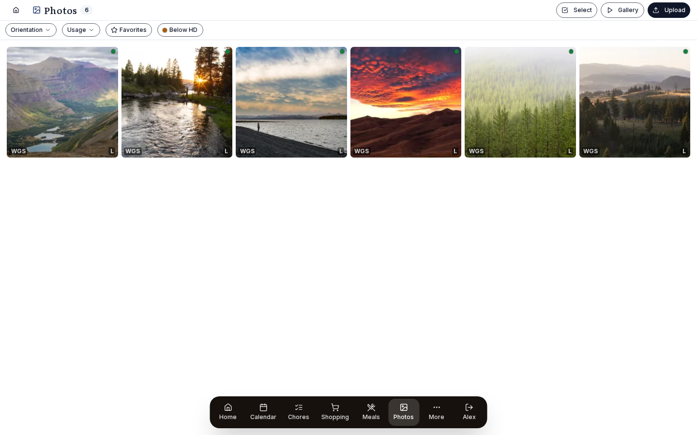

# Photos

Show your photos on the wall when nobody is using it. Upload them, or sync a OneDrive folder.

{ .hero-image }

The same photos fill the gallery, the idle screen, the wallpaper and the photo strip on the travel map. With OneDrive you pick the folders, so you never sync the whole drive.

## Set it up

### Sources

Photos come from two kinds of source.

#### Local upload

Photos you upload through Prism live in `data/photos/` on the host, or wherever you mapped the volume. This suits family photos you have already picked out.

Upload from *Photos → Add photos*. You can drag and drop or use the file picker, and add several files at once. Prism takes JPEG, PNG, WebP and HEIC (HEIC is converted to JPEG).

Each upload goes through the sharp image library, which:

- applies the EXIF rotation
- resizes to at most 2400×2400, keeping the aspect ratio
- re-encodes as JPEG at quality 85
- refuses files over 10 MB.

Prism keeps only the resized file and throws the original away after processing. If you want full-resolution copies, keep your originals somewhere else.

#### OneDrive sync

Connect Microsoft in *Settings → Integrations → Microsoft*. Then go to *Settings → Photos → OneDrive*:

- **Folder picker**: browse your OneDrive and choose the folder to sync from. Nothing is picked by default, so you can't sync your whole drive by accident.

The sync downloads new files into `data/photos/onedrive/` and keeps their EXIF metadata. It runs on its own about every 30 minutes, so a photo you drop into the folder shows on the dashboard within half an hour. Use the manual sync button in settings if you want it straight away.

The sync doesn't filter by orientation or resolution: every photo in the folder comes across. The orientation allow-lists and the low-resolution warning are display settings under *Settings → Photos*. [Filtering](#filtering) covers the Below HD filter.

You can add more than one OneDrive source, for example one folder for the family slideshow and another only for wallpaper.

##### Getting photos into the folder from your iPhone

OneDrive backs up your whole camera roll to one big folder and has no way to map an iOS album or your favorites to a folder of its own. You fill the Prism folder yourself, in one of three ways:

1. **iOS Shortcut (recommended)**: an "Add to Prism" action on the Photos share sheet, which you build once:
   - Open the **Shortcuts** app, tap **+** and name it "Add to Prism".
   - Add the **Save File** action (in the Documents category).
   - Set the destination to your OneDrive Prism folder and turn **off** "Ask Where to Save".
   - In the shortcut's settings (ⓘ), turn on **Show in Share Sheet** and set "Accepted Types" to Images.
   - From then on, select photos in Photos, tap Share, then **Add to Prism**, and they upload straight to the folder.
2. **OneDrive app**: open OneDrive, select photos in your Camera Roll backup, tap **Copy to** and pick the Prism folder.
3. **From a computer**: drag files into the folder in the OneDrive website or your synced desktop folder.

> Why not iCloud Shared Albums? Apple moved public share links to a CloudKit-only backend with no public API. [iCloud integration](ICLOUD.md#what-works-what-doesnt) has the details. For iPhone users, OneDrive plus the shortcut above is the way to do it.

#### Cross-source dedup + priority

If the same photos sit in more than one source (local uploads and a OneDrive folder, say, or two OneDrive folders that overlap), Prism shows each photo once. When it finds the same shot in several sources:

- It matches photos by capture time and dimensions. A cropped edit keeps the original timestamp but has new dimensions, so the edit and the original both show, and only true duplicates are hidden.
- The copy from your preferred source is the one shown. Order your sources in *Settings → Photos* with the ▲▼ controls; the top of the list is preferred. A new order applies at once, with no re-sync.

For example, put "OneDrive: originals" above "OneDrive: web-optimized" and any photo in both folders comes from the originals folder, with the smaller copy hidden.

### Usage tags

Each photo carries usage tags that decide where it can appear. There are no free-form labels. Open a photo in the lightbox and use the **Tag for:** row to switch on any of these:

- **Wallpaper**: can be shown as the dashboard background.
- **Gallery**: shown in the main Photos grid.
- **Screensaver**: included in the screensaver rotation.

A photo can have any mix of these, or none. The usage tags also work as gallery filters (see [Filtering](#filtering)), and there is a **Favorites** filter for photos marked as favorites.

### Pinned photos

Pinning replaces the slideshow with one fixed photo. You set pins on the Pinned Photos card in *Settings → Photos*; the lightbox has no pin option.

- **Pinned wallpaper**: the dashboard shows this one photo behind the widgets and stops cycling.
- **Pinned screensaver**: the same for the screensaver.

Use it when you want one particular family portrait behind the dashboard all the time.

A pin belongs to one device. Prism stores it in that browser's local storage, so each display can pin its own wallpaper and screensaver, or none. You can pin a wallpaper and still let the screensaver cycle through the rest.

To change or clear a pin, go back to the same Pinned Photos card in *Settings → Photos*.

## Use it

### Gallery view

The Photos page is a grid split into pages, and thumbnails load as you scroll. Click one to open the lightbox, which has:

- the full-resolution photo
- arrow keys (or swipe on a phone) for next and previous
- the **Tag for:** toggles, to add or remove the photo from Wallpaper, Gallery and Screensaver (see [Usage tags](#usage-tags))
- **Delete**, which removes the photo from Prism
- a resolution dot, with the photo's dimensions and orientation.

#### Filtering

- **Orientation**: show only landscape, portrait or square photos.
- **Usage**: show photos tagged for Wallpaper, Gallery or Screensaver.
- **Favorites**: show only photos marked as favorites.
- **Below HD**: show only photos smaller than 1920×1080, to find the low-resolution shots that will look poor full screen.

#### Bulk actions (desktop)

On a computer, tap **Select** to pick several photos at once. The button is hidden on phones.

- Tap photos to select them, or use **Select all** to select every photo that matches the filter, including those on other pages.
- **Show in:** adds or removes the Wallpaper, Gallery and Screensaver tags on all the selected photos in one go.
- **Remove from Prism**: deletes the selected photos from Prism. The source files, OneDrive included, are left alone. A photo you remove from a synced source stays removed and isn't downloaded again on the next sync.

#### Resolution indicator

Each thumbnail, and the lightbox, shows a small dot that compares the photo with 1920×1080 (HD):

- **Green**: HD or larger.
- **Yellow**: at least 75% of HD.
- **Red**: low resolution.

Use it with the **Below HD** filter to find photos too small for a full-screen wallpaper.

### Slideshow

The slideshow runs in three places:

- the **Photo widget** on the dashboard
- the **Screensaver** when it is on
- the photo display in **Away mode**.

Each of these has its own settings:

- **Rotation interval**: how often the photo changes. The default differs from place to place.
- **Source filter**: which photo sources to use.
- **Usage filter**: use only photos tagged for that place (Wallpaper, Gallery or Screensaver).
- **Orientation filter**: for example only landscape, which suits a full-screen display, or only portrait.

The browser fetches photos ahead of time and rotates them itself, so a new photo doesn't need a trip to the server.

### Travel Map photo linking

Photos with GPS data link themselves to travel pins nearby, using the Haversine formula for distance on a globe (by default within 50 km of each pin). A pin's detail panel shows a strip of the matching photos, and tapping one opens the lightbox.

The [Travel Map guide](TRAVEL.md#gps-photo-linking) covers setup and how to change the radius for each pin.

### Use cases

#### Kitchen dashboard family slideshow

Sync a "Best of 2025" folder from OneDrive and set the screensaver to cycle through it every 30 seconds. The kitchen display then shows your favorites all day.

#### Travel scrapbook

Keep location data on your phone photos (on iOS, leave "Preserve location" on when sharing to OneDrive) and sync the travel folder. When you open the Travel Map, the pins for places you have been show strips of photos taken nearby.

#### Static dashboard wallpaper

Upload a family portrait from Photos → Add. On the Pinned Photos card in *Settings → Photos*, pin it as the wallpaper, and the dashboard uses it as the background. Set the widget translucency to taste.

#### Babysitter mode background

Babysitter mode uses the screensaver photos by default, which means the ones tagged **Screensaver**. Choose that set with care (using the **Tag for:** row in each photo's lightbox) to keep the babysitter view family-friendly.

## Details

### GPS data

When a photo's EXIF data has a latitude and longitude, Prism stores them with the photo. The Travel Map uses them to link photos to travel pins nearby.

iOS removes GPS data when you share a photo, unless you change it. Turn on "Preserve location" in the photo share options, or use AirDrop with location kept, so the GPS data survives the trip to OneDrive.

#### GPS backfill

For photos that synced before you set up GPS linking, *Settings → Photos → Backfill GPS* reads the EXIF data again from the files already on the host and saves the coordinates to the database. It works on the local copies and downloads nothing.

### Performance level interaction

At the **Minimal** performance level (*Settings → Appearance → Performance*, chosen there or set by Auto):

- The Photo widget shows one fixed photo, the first one matching its filter, and stops cycling.
- A pinned dashboard wallpaper still shows, since a fixed image costs nothing per frame.

This saves processing and bandwidth on a Raspberry Pi or an older tablet.

### Caching

Prism downloads each synced OneDrive photo once and keeps it locally, in a `photos-cache` Docker volume. Expect around 1 GB, though the size depends on your library.

**Immich** photos aren't copied as the iPhone originals. The lightbox, screensaver and wallpaper ask Immich for its web-safe `fullsize` (or `preview`) JPEG or WebP, so Firefox and other browsers that can't decode HEIC still show the picture. Prism ignores HEIC files cached by an older version.

If you delete the volume, the next sync downloads everything again. The database rows stay (they hold the file path), so tags, GPS data and pins are kept.

### Privacy

- Photo files live on your Prism host. They aren't kept by Anthropic, Microsoft (once synced), Cloudflare or anyone else.
- The PWA (the app you install from the browser) caches small photo thumbnails so it can show them offline.
- The OneDrive sync only goes from OneDrive to Prism. Prism never writes photos to OneDrive, never changes files there and never deletes anything there.
- If you disconnect Microsoft in *Settings → Integrations*, the sync stops. Files already synced stay in your `data/photos/` directory and in the database, and you can delete them if you like.

### Troubleshooting

#### Photos not showing up after OneDrive sync

1. Open *Settings → Photos → OneDrive* and check the folder picker points at the right folder.
2. Tap **Sync now**.
3. Look for errors in the sync log on the Photos settings page.
4. Every photo in the folder syncs, whatever its size. If one is missing, check it really is in that folder.

#### Slideshow shows a thumbnail-quality image, not full

The screensaver uses the smaller cached copy on purpose, to keep it fast. Open the lightbox to see full resolution.

#### Wallpaper photo loads slowly

A pinned wallpaper is served at full resolution, so on a slow connection or with a large file it can take a moment to appear. The PWA caches it after the first load.

#### GPS coordinates wrong on a photo

EXIF GPS is whatever the camera recorded. With a poor GPS signal (indoors, in a basement) it can be hundreds of meters out. If the Travel Map link matters to you, edit the photo's `latitude` and `longitude` in the database by hand.

#### Photos rotation showing the same image repeatedly

The slideshow shuffles the photos that match the filter. With a narrow filter (three photos, say) you will see repeats. Widen the filter or change the tags to get a bigger pool.

#### "Backfill GPS" finds no new GPS data

There are two usual causes:
- The photos have no EXIF GPS at all. Most often this is iOS removing it on share, which it does by default.
- The photos synced through OneDrive's "stripped metadata" mode (some OneDrive Photos settings remove GPS).

To check, open the photo file's properties and look at its EXIF data.

#### "Out of disk space" during sync

The photo cache volume is full. You can:
- give the volume more space in `docker-compose.yml`
- sync a smaller OneDrive folder
- delete the `photos-cache` volume and sync again with only what you need.

#### iOS uploads come out rotated

The sharp step should apply the EXIF rotation for you. If a photo still comes out rotated, the EXIF orientation was usually missing or set to 1 (no rotation) while the pixels themselves were turned. Rotate the photo on your phone before uploading it.
