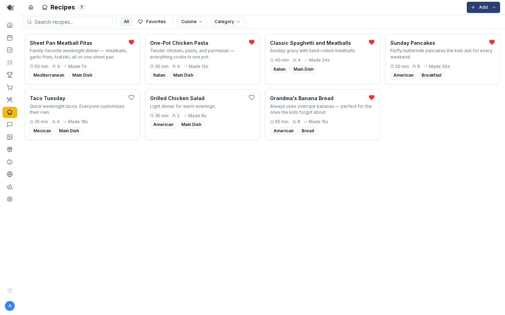

# Recipes

Keep your family's recipes in one place, add their ingredients to the shopping list, and cook from a screen you can read from the stove.

{ .hero-image }

Import a recipe from a web page, a Paprika export or pasted text, add a photo, and scale it up or down.

## Set it up

### Importing recipes

Four ways of importing cover about 95% of recipes, and a fifth pulls them from a recipe manager you already run.

#### URL import

*Recipes → Add → Import from URL.*

Paste the address of a recipe page. Prism reads the page's **schema.org Recipe JSON-LD**, the standard structured data that most big recipe sites publish so search engines can read them. That covers AllRecipes, NYT Cooking, Food Network, Bon Appétit, Serious Eats, Smitten Kitchen and about 80% of recipe sites that search engines index.

It picks up the name, ingredients, instructions, prep and cook times, servings, image URL, cuisine and category.

If the site has no JSON-LD, the import fails without saving anything. Use paste-text or manual entry for that recipe.

#### Paprika import

*Recipes → Add → Import from Paprika.*

This is for moving a library over from Paprika. Export your Paprika recipes as HTML and paste the result into the Prism import window, and they are all added at once. The HTML can be up to 5 MB, a limit that keeps a huge paste from using up the server's memory.

#### Paste recipe text (OCR-friendly)

*Recipes → Add → Paste recipe text.*

This is the easiest way to get a printed or handwritten recipe card into Prism:

1. Take a photo of the card and let iOS Live Text (or Google Lens on Android) read the words. This is OCR, short for optical character recognition.
2. Use "Select all → Copy" on the text it found.
3. Open Prism on your phone or laptop and paste into the window.
4. The parser splits the text into title, ingredients, instructions, prep and cook time, and servings. It keeps any section headings inside the ingredients.

The parser understands these:

- **Title casing**: it applies AP-style title case, so `a`, `an`, `the`, `and`, `or`, `for`, `of` and `with` stay lowercase in the middle of a title and every other word is capitalized.
- **Section markers**: headers such as `Ingredients:`, `Instructions:`, `Method:`, `Directions:` and `For the X:`.
- **Sub-section headings inside ingredients**: lines like `Fries:`, `Meatballs:` or `Sauce:` are stored as `{ heading }` entries and show in bold in the detail view.
- **"Step N:" prefixes**: each one starts a new instruction step.
- **Comma modifiers in ingredients**: `1 onion, diced and sautéed` is kept as written.
- **`" or "` alternatives**: `1 tsp dried oregano or 1 tbsp fresh oregano` is kept as written.
- **Parentheticals**: `(about 4 cups)` is kept.
- **Inline step markers**: `1. Preheat oven. 2. Mix dry ingredients.` is split onto separate lines.
- **Times**: `Prep: 15 min`, `Cook: 30 min`, `Total: 45 min` and `Servings: 4` are picked out.

The result fills in the same form that manual entry uses, so you can check and fix it before saving.

#### Manual entry

When nothing else fits, use *Recipes → Add → Create manually*, which gives you the full form with every field. In the ingredients box, the same `{ heading }` syntax works: put `Fries:` on its own line to get a bold section heading in the detail view.

#### Sync from Tandoor / Mealie

*Recipes → Add → Sync recipes (Tandoor / Mealie)…*

If you already keep your recipes in [Tandoor](https://tandoor.dev/) or [Mealie](https://mealie.io/), connect that server with its base URL and an API token and Prism pulls the recipes in.

- The server's card says whether the token **Reads only** or **Reads and writes**. In Tandoor that is the token's scope: `read` reads only, `read write` reads and writes (*Settings → API* makes one). A Mealie token always reads and writes, because Mealie has no read-only tokens. A token that reads only works as before.

- Each sync shows you a list of changes to approve first. New and changed recipes are ticked already. Removals are only made if you tick them, and a guard stops a wrongly set up source from deleting your whole library in one go.
- Running the sync again is **idempotent**, meaning it gives the same result however often you run it: recipes you already imported are matched and updated in place, so you never get a second copy.

### Per-recipe photo upload

Each recipe can have its own photo. In the recipe form you can choose:

- **Upload from device**: opens your phone's or computer's photo picker. On iOS that is the usual sheet with camera, library and files. It deliberately does not jump straight to the camera (`capture="environment"` was removed for this reason).
- **Remote URL**: paste the address of an image to use it directly.
- **Remove**: clears the photo.

Prism processes each uploaded photo with the sharp image library:

- It turns the photo the right way up using its EXIF orientation.
- It shrinks it to fit within 1200×1200, keeping its shape.
- It saves it again as a JPEG at quality 85.
- It checks the file's first bytes to make sure it really is an image, and refuses anything else.
- Files over 10 MB are refused.

The photo is stored at `data/recipe-images/<recipeId>.jpg` and served from `GET /api/recipes/<id>/image`, which is rate-limited.

It appears on the recipe's card in the gallery and at the top of the detail window.

## Use it

### Browsing + filtering

The Recipes page is a grid of recipe cards. Each card shows the photo, name, cuisine, category and cook time, with a heart for favorites.

You can filter with:

- **Search**: matches the name, description, cuisine and category, ignoring upper and lower case.
- **Cuisine** dropdown.
- **Category** dropdown.
- **Favorites only** toggle.
- **Clear filters** button.

Click a card to open the recipe's detail window.

### Recipe detail modal

Clicking a recipe card opens its detail window, laid out in the sections below.

#### Header

- The recipe name, cuisine and category badges, and prep and cook time.
- **Favorite toggle** (the heart).
- **Maximize**: opens a larger window that is easier to read on a wall display.

#### Servings + scaling

The servings line shows the current number of servings with **+/- buttons** that change it by one. Under them are five quick-scale buttons:

- **½× / 1× / 2× / 3× / 4×**

Tap one to multiply the recipe's original servings by that amount. ½× rounds up to a whole serving, so a 3-serving recipe goes to 2 servings instead of 1.5. The button you chose stays highlighted so you can see which size you are looking at.

The ingredient amounts update to match. When a scaled amount lands on a common fraction it shows as that fraction, written in plain characters (`1/4`, `1/3`, `1/2`, `2/3`, `3/4`). Anything else shows as a number rounded to two decimal places.

#### Ingredients

- Section headings show in bold.
- Tap an ingredient to strike it through while you cook, once it is in the bowl.
- The strikethroughs clear when you close the window.
- The amounts shown are the scaled ones.

#### Instructions

- Steps are shown one per line.
- Line breaks from the source are kept.
- Long steps wrap onto the next line (the text uses `whitespace-pre-wrap`).

#### Add to shopping list

- The **Add to Shopping List** dropdown lets you choose which list gets the ingredients.
- The current scale carries over: if you are looking at the recipe at 2×, the shopping items go in at twice the amounts.
- Section headings are left out, since they only group the ingredients and are nothing to buy.

#### Notes + URL

- Your notes appear under the instructions.
- A "View original recipe" link appears when the recipe has a source URL.

### Meal integration

Recipes connect to meals on the weekly Meals planner:

- In the Add/Edit Meal window, the **Recipe** picker is a dropdown you can search.
- Choosing a recipe fills in the meal name, description, prep time, cook time and recipe URL.
- Marking a meal **cooked** adds one to the linked recipe's `timesMade` count and updates `lastMadeAt`.

You can also plan a meal from the recipe itself. The detail window has a small **Add to Meal Plan** calendar covering two weeks. Pick a day, choose a meal type (Breakfast, Lunch, Dinner or Snack, with Dinner chosen to start with) and tap **Add to Plan** to put the recipe on the meal planner.

Once a recipe has been cooked, its card shows a **Made N×** badge, so you can see at a glance which recipes you make often and which have sat untouched for a while.

## Details

### What's in a recipe

Each recipe has:

- **Name** (required)
- **Description**
- **Ingredients**: a list of `{ text }` and `{ heading }` entries. Headings show in bold; text entries are the ingredients themselves.
- **Instructions**: plain text, with each line break starting a new step.
- **Prep time + cook time** (minutes)
- **Servings**
- **Cuisine** (Italian, Mexican, Thai and so on)
- **Category** (Main Dish, Dessert, Breakfast, Bread and so on)
- **Tags**: any words you like (`weeknight`, `kid-friendly`, `vegetarian`, `sheet-pan`).
- **Source URL**: an optional link back to the original.
- **Image**: an uploaded photo or a remote URL.
- **Rating** (1 to 5 stars)
- **Notes**
- **Favorite**: yes or no.
- **Times made**: a count that goes up by one when a meal linked to this recipe is marked cooked.
- **Last made**: when it was last cooked.

### Print + share (planned)

For now the only way to share a recipe is the detail window itself: show someone the screen, or save the page's address. A print layout and a read-only link you can send are planned and have not shipped yet.

### Troubleshooting

#### URL import returns "no schema.org Recipe data"

The site does not publish structured data. Prism sometimes falls back to reading the page's plain text, but usually you will need to copy the recipe and use paste-text.

#### Paste import got the title wrong (no caps / weird caps)

Title casing keeps a short list of words lowercase (`a, an, the, and, or, for, of, with, in, on, at, to, by`). Fix the title by hand in the form before you save.

#### Paste import didn't split into steps

The parser looks for numbered steps (`\d+\.\s`) or `Step N:` at the start of a line. Bulleted instructions with no numbers end up as one block of text. Paste again with `1.`, `2.`, `3.` numbering, or split the steps by hand in the form.

#### Recipe scaling rounded oddly

Only ¼, ⅓, ½, ⅔ and ¾ show as fractions (written `1/4`, `1/3`, `1/2`, `2/3`, `3/4`). Every other scaled amount shows as a number rounded to two decimal places, such as `0.67 cup`. If the exact amount matters, correct it by hand before you send it to the shopping list.

#### Photo upload "Failed to remove photo"

This is the real error from the API. Older versions said only "Failed" and hid the cause; since v1.8 the actual reason comes through.

#### Photo doesn't show on web (only on phone)

The browser is showing an old cached copy. Hard-reload with Ctrl+Shift+R, or remove the PWA and install it again. Images come from `GET /api/recipes/<id>/image` with a query string that changes when the image does, but a service worker that caches hard can still serve the old one.

#### "Add to Shopping List" returns "too many requests"

You have hit the rate limit of 120 requests a minute. Prism adds the ingredients one at a time, so a long list can go over it for a moment. Wait a minute and try again. Sending them all in one request is planned.

#### Section headings appearing as ingredients on the shopping list

This should not happen, because headings are filtered out by their `{ heading }` field. If one does show up, the recipe probably has `Fries:` saved as a `{ text }` entry, which Prism treats as an ingredient. Edit the recipe and make that line a section heading.
