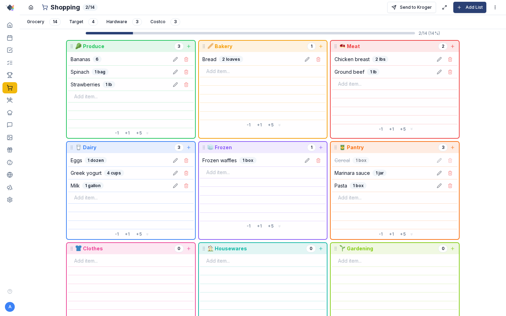

# Shopping

Keep shared shopping lists that everyone can add to, then shop from your phone or send the list to your grocery cart.

{ .hero-image }

You can keep several lists and sort items by category. Add items by typing or by scanning a barcode with the phone camera or a USB scanner. A list can sync with Microsoft To Do, and one tap sends it to your online Kroger cart.

## Set it up

### Lists

Prism holds as many shopping lists as you like. Families tend to set up something like these:

- A grocery list laid out by produce, dairy, meat, bakery, frozen and pantry.
- A hardware list for Home Depot or Lowe's runs.
- A general list for Target, Costco or anywhere else that sells a bit of everything.
- One list per store, for example separate Mariano's and Costco lists for the same week, each with its own default store in the Kroger picker.

Create one in *Shopping → New List*. Each list has:

- **Name**
- **Icon** (a Lucide icon name)
- **Color**
- **List type**: `grocery`, `hardware` or `general`. This sets the category layout; grocery uses the six-category grid.
- **Visible categories**: leave it empty (null) to show all, or pick a subset for a non-grocery list.
- **Assigned member** (optional): for a personal list that only one family member should see.

Tap a list's tab to switch to it. The list you were on is remembered in the browser's localStorage.

### Categories

Grocery lists sort items into a grid of six categories:

- **Produce** (green)
- **Bakery** (brown)
- **Meat** (red)
- **Dairy** (blue)
- **Frozen** (cyan)
- **Pantry** (amber)

On other lists a category can be any word you like, such as `clothes`, `housewares`, `electronics` or `garden`.

#### Drag-to-reorder

With a mouse, drag a category by its header, which carries a **grip icon** (⋮⋮). On a touchscreen, press and hold anywhere on a category for half a second and then drag it, the same way you move a meal. If your finger moves straight away, the page scrolls instead. Put the categories in the order you walk through your store. The order is saved in localStorage as `prism:grocery-category-order` and applies to every grocery list.

#### Empty rows

Each category card starts with six empty lines to type into. The **+1**, **-1** and **+5** buttons change the count for that card. A card always keeps at least one empty line so you have somewhere to tap.

### Microsoft To Do sync

Each shopping list can sync with one Microsoft To Do list. Set it up in the **Microsoft** provider card under *Settings → Integrations*:

1. Connect Microsoft (a one-time OAuth sign-in).
2. Pick a Prism shopping list.
3. Pick the Microsoft To Do list to sync it with.
4. Turn sync on.

Sync runs both ways, and when the two sides disagree the newest change wins. Items added or checked off on either side show up on the other. This helps when some of the family use the Microsoft To Do phone app and never open Prism.

## Use it

### Adding items

You can add an item three ways:

1. Type in the text field inside a category card and press Enter. The item goes into that category. Pressing Tab or clicking away also adds it.
2. Tap the **+** button in a category header to open the Add Item window with that category already chosen. Use this when you want to set a quantity, unit or note as you add it.
3. Scan a barcode with the phone camera or a USB scanner (see below). Prism fills in the name from Open Food Facts and picks a category.

Each item has:

- **Name** (required)
- **Quantity** (a whole number)
- **Unit** (free text, such as `gallon`, `lbs`, `oz`, `dozen` or `box`)
- **Category**
- **Notes**

### Toggling items

Tap an item's row to check it off. The text gets a line through it and fades. The progress bar at the top of the list moves as you go.

There are no checkboxes because the whole row is the tap target, which is easier to hit with one hand in the store.

The line appears as soon as you tap, before the server has answered, so it feels instant on a slow connection. In the rare case the server refuses the change, the row goes back to how it was.

### Editing / Deleting

Every item row has an **Edit** (pencil) and a **Delete** (trash) button on the right, always visible:

- **Edit** opens the item's window with its current values.
- **Delete** removes the item at once. Deletes cannot be undone; the Undo button in the nav bar only reverses a check-off.

### Barcode scanning

#### Phone camera (PWA + browser)

Tap the **camera icon** in the Shopping header to open a full-screen scanner. It uses the device camera and the ZXing library to read the barcode. When a scan succeeds:

1. The phone vibrates, where the device supports it.
2. A tone plays. On iOS, tapping "Open Camera" is what allows the sound to play.
3. The scanner closes by itself.
4. Prism looks the product up on **Open Food Facts**, which needs no API key, for its name, category and image.
5. The item is added to the active list with a suggested category.

If the scanned item is already on a list, Prism asks which list to add it to, or you can cancel.

#### USB HID scanners

A USB barcode scanner works on a desktop as soon as you plug it in. The computer treats it as a keyboard (HID, the standard for keyboards and mice), so the scanner "types" the barcode into whatever has focus. Prism listens for key presses across the page, and when a run of keys looks like a barcode it treats it as a scan. You need no drivers and no settings.

It has been tested with scanners from Honeywell, Eyoyo, Symcode and NADAMOO.

### Send to Kroger / Mariano's

Once you connect a Kroger account (*Settings → Integrations → Kroger*), the Shopping header shows a **Send to Kroger** button. Tap it to open the SKU picker (a SKU is one specific product in the store's catalog).

The picker goes through each unchecked item on the active list in turn:

- It offers up to five products for each item.
- Each product shows its image, name (cut to two lines), brand, size, **price** and a **normalized unit price** (per lb, fl oz or count) so you can compare the products on the page directly.
- **Quantity controls**: the +/- buttons set how many go in the cart, from 1 to 99.
- **Search override**: change the search words when the parser has cut too much.
- **Skip**: leave this item out of the cart. It stays on the Prism list.
- **Back**: go back and pick the previous item again.
- **Add**: put the chosen product in the cart and move to the next item.

At the end a review screen lists every product added, with `× N` beside anything you added more than one of, and the estimated total. You then open the Kroger or Mariano's app or website to choose a pickup time and check out.

#### Banners supported

One Kroger account works at every store brand Kroger owns:

> Kroger · Mariano's · Ralphs · King Soopers · Fred Meyer · QFC · Smith's · Fry's · Harris Teeter · Pick 'n Save · Metro Market · Pay Less · Food 4 Less · Foods Co. · Bakers' Plus · City Market · Copps · Dillons · Gerbes · Jay C · Ruler Foods

#### SKU caching

When you pick a specific product (`Mariano's 2% Reduced Fat Milk Gallon`) for a plain item like `milk`, Prism saves that product's ID on the shopping item. The next time you send `milk`, that product is already selected, so after the first trip your weekly staples take one tap each.

#### Setup

The [Kroger integration guide](KROGER.md) walks through the whole setup: creating the Kroger developer app, getting the Client ID and Secret, connecting it in Prism and picking your default store.

### Shopping mode (full-screen in-store)

Tap the **maximize icon** in the list header to switch to shopping mode. The list fills the screen, the list tabs and filter buttons are hidden, and a small header shows the list name and a progress badge, so all the height goes to items.

It is meant for using a phone in one hand while you push a cart. Tap **minimize** to leave.

### Progress + celebration

The progress bar at the top of each list shows how many items are checked out of the total. When you check off the last one, a short animation plays: a shopping cart rolls across the screen with a kid riding in it, arms up, trailing confetti, and "All Done!" bounces in. It goes away by itself after 3 seconds.

The animation is skipped if the device asks for reduced motion (`prefers-reduced-motion`) or Prism's performance level is set to Reduced or Minimal.

### Multiple shopping lists workflow

Here is one way a family might split things up:

1. **Grocery** is the main list. It syncs to Microsoft To Do and goes to Kroger each week.
2. **Costco** is a separate list for bulk items. It never goes to Kroger, because Costco is not part of the Kroger API.
3. **Hardware** is a non-grocery list for Home Depot or Lowe's runs.
4. **Target** uses open categories for whatever the next Target trip needs.

Each list keeps its own default store, gets checked off on its own schedule and has its own sync settings.

## Details

### Per-person attribution

Each item stores `addedBy`, the family member who added it. The list does not show this yet, and you cannot filter by person.

### Troubleshooting

#### "Failed to add item: too many requests"

You have hit the rate limit of 120 requests a minute. Recipe imports add ingredients one at a time and can briefly go over it. Wait a minute and you can add items again.

#### Send to Kroger button missing

The button only appears when there is something to send. Either Kroger is not connected (*Settings → Integrations → Kroger*) or the active list has no unchecked items.

#### SKU picker shows "no price" everywhere

You have not set a default store. Go to *Settings → Integrations → Kroger → Set store* and enter your zip code. With no store set, Kroger's API returns nationwide product data with no store prices.

#### SKU picker can't find an obvious item

Before searching, the parser removes quantities, units, anything after a comma and any `" or "` alternative. For `1 Fresno pepper, seeded and sliced, or ½ teaspoon crushed red pepper flakes`, it searches for `Fresno pepper`. That can still miss, so type a better term in the **search override** box above the products.

#### Barcode scanner shows the wrong category

Open Food Facts is built by volunteers and its categories are sometimes off. Edit the item after it is added to fix it.

#### USB scanner not capturing

The scanner only reaches Prism when the Prism page has keyboard focus. If an open window is taking the key presses itself (an `<input>`, for example), Prism stops listening for scans. Close the input or go back to the list.

#### Microsoft To Do sync stuck

Open the **Microsoft** provider card under *Settings → Integrations* and tap **Sync now**. If that does not help, check the card's connection, because the sign-in may have expired.
