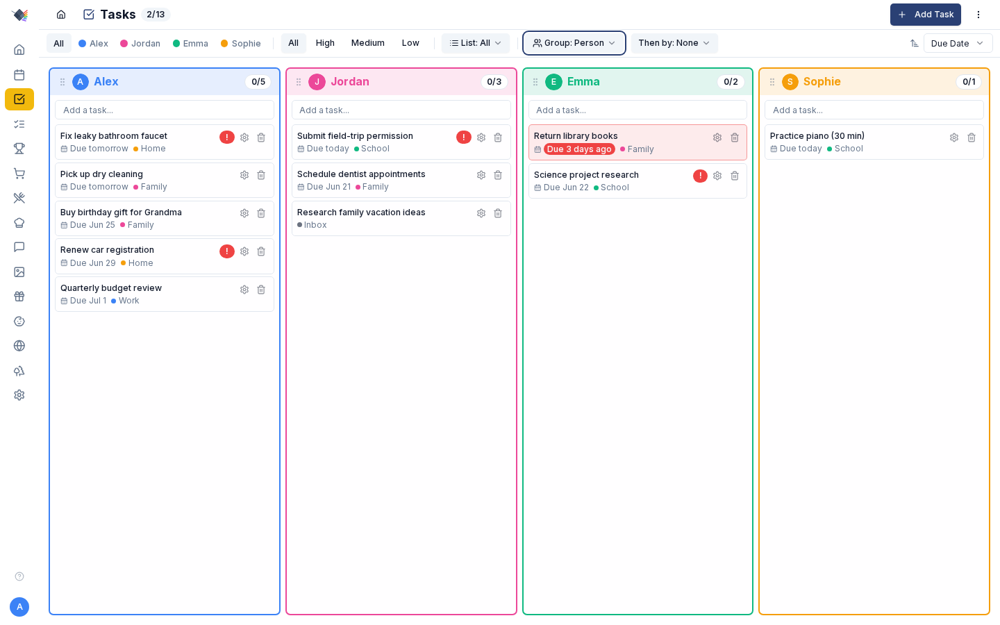

# To-dos

Keep to-dos for each person, with due dates, and sync them with Microsoft To Do or Google Tasks.

{ .hero-image }

Each to-do can have a person, a due date, a priority and a list. Use whichever sync service your family already has; Prism looks the same either way.

## Set it up

### Task lists

Lists are the main way to organize tasks. Families often use lists like these:

- **Inbox** for anything not sorted yet.
- **Family** for shared household jobs such as groceries and errands.
- **Home** for maintenance and repairs.
- **Work**, one per parent.
- **School**, one per child.

Create lists in *Settings → Integrations → (Google or Microsoft) card → New List*. Each list has:

- **Name**
- **Color**: shown as a colored dot in the list picker and as a tag on each task.
- **Sort order**: drag lists in the picker to reorder them.
- **External sync source**: an optional Microsoft To Do or Google Tasks list to sync with in both directions.

When you delete a list, its tasks move to the inbox with no list. The tasks themselves stay.

### Sync providers

Each Prism instance uses one provider.

#### Microsoft To Do (bidirectional)

1. In *Settings → Integrations → Microsoft* card, connect your account.
2. In the same card, pick a Microsoft To Do list for each Prism list you want to sync.

Sync runs both ways, and the newest change wins. It covers the title, the notes (which become the description), whether it is completed, and the due date.

Microsoft To Do's steps (its sub-items) are **not** imported. Prism has no subtasks, so it skips them instead of folding them into the task. Attachments are not imported either.

#### Google Tasks (bidirectional)

1. In *Settings → Integrations → Google* card, connect your account. This is the same Google sign-in used for Calendar, with Tasks access added.
2. In the same card, choose which Google Tasks list goes with which Prism list.

It works the same as Microsoft: both ways, newest change wins, and it syncs the title, notes, completed state and due date. Subtasks come in too, indented under their task in the order Google keeps them, each with its own due date and notes, and ticking one off in Prism ticks it off in Google. Ticking a task leaves its subtasks as they are, as Google does. Attachments are not imported.

**No public web address?** Google's browser sign-in has to send you back to an address Google accepts, and an install that only runs on your home network has none. Use *Connect without a public URL (advanced)* on the same card and paste a refresh token (a long-lived key that lets Prism sign in again on its own) made in Google's OAuth Playground, with `https://www.googleapis.com/auth/tasks` among the scopes. Prism then takes you straight to the list picker. CALENDAR.md has the full walkthrough; the only change for tasks is the scope.

#### Removed tasks are held for review

When the provider stops listing a task you sync, Prism does **not** delete it. The task stays on screen and a **Review** button appears in the Tasks header, where a parent decides for each task:

- **Delete**: remove it from Prism as well.
- **Keep**: make it a local task. It stops syncing and is never sent back to the provider that dropped it.

Two checks come first:

- A task has to be missing for longer than one sync interval before it is flagged. A task you have just created is never reported as deleted, and one missed response from the provider flags nothing.
- If an unusual number go missing at once (more than ten, or at least half of a set of four or more), **nothing is flagged at all** and the source records an error instead. That pattern looks like the provider having an outage, and a long list of flags would tempt you to confirm them all in one go.

If a flagged task shows up at the provider again, its flag clears on the next sync without you doing anything.

Task sources from Apple Reminders (CalDAV) work the same way.

#### Auto-sync

- Only a parent's session syncs. On a child profile the page still shows tasks but does not fetch new ones.
- When the dashboard opens, it syncs if the last sync was more than 5 minutes ago.
- It syncs again in the background every 5 minutes.
- Syncing pauses while the browser tab is hidden and starts again when you come back to it.
- The screensaver keeps syncing too when it shows the Tasks widget.

The manual sync button is always there, which helps right after you add a task on the other service.

## Use it

### Adding tasks

- The **Add Task** button opens the window with every field.
- The text box at the top of the Tasks page adds a task in one step: type a title and press Enter. The task goes into the view you are filtered to.

Both need someone logged in, parent or child. The text box records the logged-in person as `createdBy`.

### Completing tasks

Tap the checkbox to mark a task done. The row gets a line through it and fades. The undo button in the nav bar can reverse it for about 5 seconds.

If the task syncs with Microsoft To Do or Google Tasks, the completed state goes to that service on the next sync.

### Deleting tasks

Only parents can delete tasks. You can do it from the trash icon on the task's row, or the **Delete** button in the task's edit window. Both ask you to confirm.

Deleting a synced task also deletes it at the provider straight away, without waiting for the next sync. If the provider cannot be reached, Prism still removes the task and leaves a marker (a tombstone) so the next sync does not bring it back. Either way the task stays deleted.

### Filtering + sorting

- **By list**: the picker offers "All lists", "Unassigned" or a single list.
- **By person**: tap someone's avatar along the top.
- **By priority**: a filter chip.
- **Show completed**: off to start with. Turn it on and finished tasks appear at the bottom, struck through.

You can sort:

- **By due date**: overdue first, then today, then later dates, with undated tasks last.
- **By priority**: high, then medium, then low.
- **By title**: A to Z.

### Grouping

The Group dropdown can group tasks one level deep or two:

- **None**: one flat list.
- **By Person**: a card for each family member.
- **By List**: a card for each task list.
- **Then by**: a second level inside the first. With Person as the first level you can split each card by List, or the other way round. The second level shows as dividers with a colored left edge inside each card.

If you drag the group columns into a new order, that order is saved in localStorage (`prism:task-group-order` for one level, `prism:task-nested-group-order` for two). The grouping you chose is not saved.

### Reordering

You can drag tasks within a group with touch or a mouse. Prism does not save the order of individual tasks; it only saves the order of the group columns (see Grouping).

To move a task to another list, drag it onto that list's card header.

### Undo

One undo history covers tasks, chores, shopping items and wishes. After you complete or delete a task, an **Undo** button shows in the nav bar for about 5 seconds. Tap it to reverse your last action.

### Mobile behavior

On a phone:

- Tasks sit in one column under a smaller header.
- Filters fold away; tap "Filters" to open or close them.
- The drag handles (GripVertical icons) are hidden. To drag a task, press and hold its row.
- Cards cannot be dragged, so scrolling up and down works normally, while single tasks can still be dragged.

### Common workflows

#### Recurring chore that's really a task

Sometimes "Take out trash every Friday" is more of a personal to-do than a chore that earns points. Add it as a task in the Home list with a due date of this Friday. When you finish it, copy it by hand with next Friday's date.

(Prism does not repeat tasks on its own yet; that is planned.)

#### Grocery list as tasks

Some families like the Shopping page, and others would sooner keep everything in one task list. Microsoft To Do sync can copy shopping items into a To Do list for you. The [Shopping guide](SHOPPING.md) explains how to set it up for each list.

#### Sharing a list with a non-Prism family member

Use the Microsoft To Do or Google Tasks sync. Share the list with the other person in Microsoft or Google. They see and edit it in Microsoft To Do or Google Tasks, and you see the same tasks in Prism through the sync.

## Details

### What's in a task

- **Title** (required)
- **Description**: you cannot edit it in Prism's task window. It only comes across from the notes in Microsoft To Do or Google Tasks when they sync.
- **List**: the task list it belongs to. It can be empty, which means the inbox.
- **Assigned to**: a family member, or nobody.
- **Due date**: a date and time, optional.
- **Priority**: high, medium or low. New tasks start at medium, and there is no "none".
- **Category**: any tag you like (`Health`, `School`, `Errands`, `Shopping`).
- **Completed**: yes or no. When a task is completed, `completedAt` and `completedBy` are filled in.

### Troubleshooting

#### Tasks not syncing

1. Open *Settings → Integrations → (Google or Microsoft) card* and check the provider is still connected.
2. In the same card, check that sync is turned on for the list.
3. Tap **Sync now** to sync straight away.
4. Look at the list in the other service and check the task you expect is there.

#### Two-way sync created duplicates

This usually happens once, when a task was created in both places before the first sync ran. Delete the duplicate and the deletion syncs across.

#### Completed task came back uncompleted

The other service marked the task not done, and because the newest change wins, Prism took that change. Check what happened on the other side, and mark the task done again if you want it gone.

#### "Create List" button missing

Lists are created in *Settings → Integrations → (Google or Microsoft) card → New List*. The Tasks page has no button for making a list; its picker only shows lists that already exist.

#### List deletion deleted my tasks

That should not happen: deleting a list moves its tasks to the inbox. If tasks did disappear, look in the audit log (*Settings → Activity Log*) to see what was actually done.

#### Sub-grouping (Person → List) looks weird

Two-level grouping always puts the first level in cards and the second as dividers with a colored left edge. If that gets confusing, go back to one level of grouping, or set "Group: None" and sort instead.
