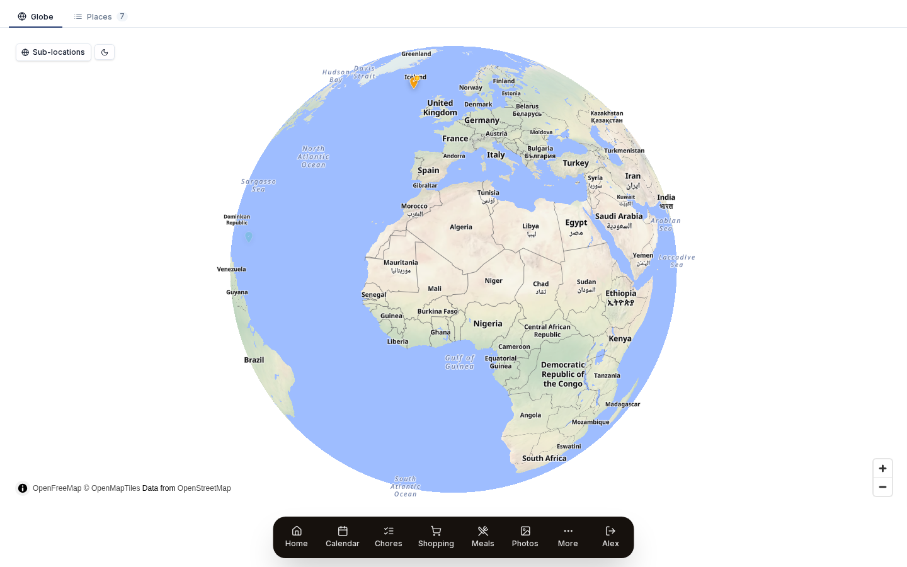

# Travel map

Pin the places your family has been, or wants to go, on a globe.

{ .hero-image }

Group stops into trips, and photos from OneDrive that carry a location appear at the place they were taken. The map needs no API key.

## Use it

### What's a Travel pin vs. a Trip

The Travel Map holds two kinds of thing:

- **Pin**: one place, fixed by latitude and longitude. It has a name, a status (visited or want to go), a bucket-list flag, dates, notes and tags.
- **Trip**: a journey with several stops, each of which is a pin. A trip has its own name, style (route, loop or hub) and dates. Its stops are pins with `pinType: 'stop'` or `'national_park'`.

The globe shows both at the same time. A standalone pin stands on its own; a trip stop belongs to its trip.

### Places (standalone pins)

The **Places** tab lists every standalone pin, with stats, filters and search.

#### Statuses

Each pin has a status, shown by its colour on the globe:

- **Been there** (green checkmark): you have visited.
- **Want to go** (white dot): on the wishlist.
- **Bucket list** (amber star): a place you really want to get to. This is a separate flag and works with either status.

A status change saves as soon as you tap it, with no Save button.

#### National parks badge

A pin with at least one entry in its `nationalParks` array gets a green tree badge. The entries are official NPS park names, such as "Yellowstone National Park" or "Grand Canyon National Park". The "Has NP" filter pill uses them.

#### Filters

The filter pills at the top of the Places tab are:

- **All**: every pin
- **Been there**
- **Want to Go**
- **Bucket List**
- **Has NP** (national park)

There are also:

- **Group by**: Year, Country or None. Grouping by country puts the country's flag emoji on each section heading.
- **Search**: finds any place or trip whose name contains what you type, ignoring case.

The list sorts itself and has no sort control. Visited places come newest first by visit date, and everything else is in alphabetical order by name.

Selecting a place takes you to the globe and opens its detail panel.

### Adding a place

You can add a place in two ways:

1. **Geocoded search.** Type a place name in the side panel and pick one of the Nominatim suggestions (Nominatim is OpenStreetMap's place search). The pin lands at those coordinates with the official name and country.
2. **Click on the globe.** A pin drops where you click, and a reverse lookup fills in the place name.

When you add something new, the slide-out panel has a **Place / Trip toggle**, so you can switch between a standalone pin and a trip with several stops without leaving the panel.

#### Editing a pin

Click a pin to open its detail panel. You edit right there in the panel, with no separate edit window:

- **Name**
- **Trip label** (free text such as "Spring Break 2026", separate from Trip objects)
- **Status toggle** (saves on tap)
- **Bucket list star** (saves on tap)
- **Visit dates**: a start date and an optional end date.
- **Description**
- **Tags**

#### Re-locating a misplaced pin

The pencil icon next to the coordinates opens a place search in the panel. Type the new location and pick a result, and the pin's latitude, longitude and place name update where they are. This helps when the geocoder put a pin in the wrong town of the same name (there are about 30 Springfields).

### Trips

A trip is a journey with several stops. You pick one of three styles when you create it:

- **Route**: A → B → C → D, with a line joining the stops in order.
- **Loop**: A → B → C → A, with the line closing back at the start.
- **Hub**: a home base with day trips out from it. The home stop is marked `isHub: true` and the other stops spread out from it.

Trips are objects in their own right, separate from standalone pins. You create one with the **Place / Trip toggle** in the add panel.

#### Trip stops

Each stop in a trip is a pin with `pinType: 'stop'` or `pinType: 'national_park'`. A stop has:

- every field a standalone pin has
- a **sortOrder**, so the line is drawn in the right order
- an optional **national park** flag, which shows a green tree icon in place of the number badge.

Drag stops to reorder them in the trip's detail panel.

#### Trip rendering

Every trip shows on the globe at all times:

- **Inactive trips** show as small faded coloured dots with thin, faint lines between them, enough to tell you they are there.
- **The active (selected) trip** shows full numbered markers and a bright dashed line, all in the trip's colour.

Click a faint dot to select its trip (the click passes from the marker up to the trip it belongs to).

#### Active trip indicators

When you select a trip:

- its name and dates appear in a banner at the top of the globe
- the side panel lists its stops in numbered order
- the line between the stops takes the trip's colour
- national park stops keep their green tree icon.

### GPS photo linking

If you have set up OneDrive photo sync, photos with GPS data match themselves to travel pins nearby. A pin's detail panel shows a strip of the photos taken within 50 km of it.

#### How matching works

Prism works out the matches each time you open a pin's detail panel. It stores no links and runs no background job.

1. When a photo syncs from OneDrive, Prism saves its EXIF GPS coordinates (if it has any) on the `photos` row.
2. When you open the pin panel, the Travel Map finds the distance from the pin, and from all its stops and national parks, to every photo with GPS. It uses the Haversine formula for distance on a globe, first narrowing the photos with a rough box in SQL and then checking the exact radius.
3. Photos within 50 km come back and show as a strip across the panel. Tap one to open the lightbox.

#### GPS backfill

For photos that synced before Prism saved GPS data, run *Settings → Photos → Backfill GPS*. It reads the EXIF GPS data from the files already synced, without downloading them again, and fills the `photos.latitude` and `photos.longitude` columns. A photo with coordinates shows up the next time you open a pin near it.

#### Match radius

The 50 km radius (`photoRadiusKm`) is a fixed default set in the API and database. You can't change it for a pin today, and the pin panel doesn't let you edit it.

### Globe controls

- **Drag** to turn the globe.
- **Scroll wheel** or **pinch** to zoom.
- **Sun / moon button** in the corner switches a dark-map filter on and off. The filter runs a CSS `brightness · saturate · contrast · hue-rotate` chain on the map tiles only, so the tiles go dark and the markers stay at full brightness. The tiles don't have to reload.
- **Globe vs. flat projection**: the default is the 3D globe, MapLibre's `projection: globe` setting. When you zoom in close, MapLibre may slide over to a flat Mercator map.
- **Sub-locations toggle** (top left): when on, every pin's stops and national parks show on the globe at once. When off, they show only for the pin you have selected.

#### Initial zoom

The starting zoom makes the Earth nearly fill the screen. To start closer or further out, change `zoom` in the initial view options.

### Use cases

#### Family travel scrapbook

Drop a pin for every place you have been together, and use the status filters to see the ones you have done. Photos link to the pins through their GPS data, so each pin becomes a small album.

#### Planning the next trip

Create a trip in the route style for a road trip and add the stops in order. The line on the globe gives you a preview of the route. Use the bucket-list flag for places you would like to fit in but haven't settled on yet.

#### "Have we been to all the national parks?"

Add national park entries to your pins. The "Has NP" filter shows how many parks you have collected, and the curated NPS list helps you find the ones you haven't been to.

#### Personal globe wallpaper

The globe works well as a screensaver. Add the Travel Map widget to your screensaver layout for a slowly turning Earth that shows where your family has been.

## Details

### Geocoding

Geocoding means turning a place name into coordinates. Prism uses two sources for it:

- **Nominatim**: OpenStreetMap's search, reached through `/api/travel/geocode` (Prism's server passes the request on to OpenStreetMap's Nominatim). Prism uses it for general place search.
- **NPS curated list**: a fixed list of US National Parks and Monuments, used for the "Add national park" action in trips. It skips Nominatim, because Nominatim often answers a park name with a natural feature (for example "Hawai'i Volcanoes" matches the volcano summit and misses the park boundary).

#### Quirks the geocoder handles

- **Hawaiian island aliases**: "Big Island" becomes "Hawaiʻi Island" and "Kauai" becomes "Kauaʻi".
- **Special characters**: accents and other diacritics are normalised so near matches still work.
- **National park boundary scoring**: for national park searches, results with `class=boundary` or `class=park` rank above natural features.

### Privacy

Your travel data lives in your Prism database. Coordinates, place names, dates and photo links stay on your instance.

Place searches go to `/api/travel/geocode` on your server, which passes them to Nominatim, OpenStreetMap's public service. Nominatim sees the place names you search for, and never sees your saved pins.

Map tiles come from OpenFreeMap (`https://tiles.openfreemap.org/...`). Tile requests are ordinary public web requests. They show which part of the globe you are looking at while you use the map, and carry no personal data.

For more isolation you can host the OpenFreeMap tiles yourself (the project publishes Docker images for its tile server) and then change the tile URL in the globe component.

### Troubleshooting

#### Pin appears in the wrong location

Nominatim sometimes picks the wrong place of the same name. Click the pencil icon next to the coordinates and search for something more specific, such as "Springfield, IL" for "Springfield". The pin moves where it is.

#### "Something went wrong" creating a pin

Older versions had a Zod schema that refused `null` in optional fields and accepted only `undefined`. v1.4 fixed it. If you still see the error when creating a pin, file an issue with the exact name and tags.

#### Pin visible on the wrong side of the globe (through the Earth)

Early v1.5 had a bug where hiding pins on the far side lacked the CSS `!important` flag, so MapLibre showed them anyway. It is fixed; do a hard reload to clear the old cached files.

#### Status toggle doesn't persist

The status toggles (been there, want to go) and the bucket list star save when you tap them. If one flips back, look for the PATCH request in the browser's network tab. The usual cause is a 401 because your session expired, so log in again.

#### Photos not linking to pins

There are three possible causes:

1. The photos have no GPS EXIF data. Check the photo's metadata: not every phone records GPS, and iOS removes it on share unless "preserve location" is on.
2. The photos haven't been through GPS backfill. Run *Settings → Photos → Backfill GPS*.
3. The place is more than 50 km from where the photos were taken. Matching uses a fixed 50 km radius, so photos from further away don't attach.

#### Globe rotation feels jerky on a Pi

MapLibre's globe projection works the GPU hard. On low-power hardware you can:

- set *Settings → Appearance → Performance* to Reduced or Minimal
- turn off other widgets to leave the GPU more room
- switch to the flat Mercator map, which looks plainer but is lighter, by setting `projection: 'mercator'` where the globe starts up.

#### "Hawaii Volcanoes" pin is on top of the volcano summit

This came from how Nominatim ranked results. Prism now ranks boundary and park results above natural features for national park searches. If you still see it on Hawai'i Volcanoes or another park, file an issue and update the manual override list.

#### Trip polyline crosses the antimeridian (180° line) awkwardly

This is a known MapLibre issue. A trip across the Pacific (the US to Japan, say) draws its line the long way round the globe. You can split it into two trips that don't cross the 180° line, or live with it.
