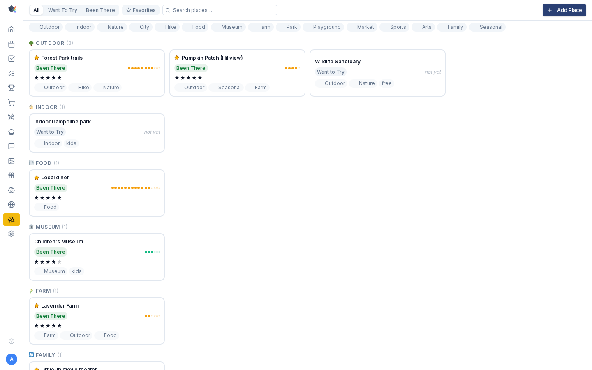

# Weekend ideas

Keep a list of local places to go, for the next time someone asks what to do this weekend.

{ .hero-image }

The [travel map](TRAVEL.md) is for trips; this list is for places nearby.

## Use it

### What it tracks

A weekend place is anywhere your family might spend a few hours: a park, restaurant, museum, trail, farm, drive-in or indoor play spot. Each entry has:

- **Name** (required)
- **Description**: what it is and why it's worth a trip.
- **Website**: an optional link to the place's site.
- **Status**: `Want to Try` (you haven't been yet) or `Been There` (you have).
- **Favorite**: a star you can filter on.
- **Rating**: 1 to 5 stars on the place, which you can set once it is marked "Been There".
- **Notes**: any text you like.
- **Tags**: picked from a fixed set (see [Tags](#tags)).
- **Visit count**: goes up by one each time you log a visit.
- **Last visited**: the date of the latest logged visit.

A place can also hold a location (place name, address, latitude and longitude), which shows in the detail panel when it is there. You can't edit the location from the app yet.

### Adding a place

*Weekend → Add place* opens the form. Only the name is required.

A new place starts with one of two statuses:

- **Want to Try**: the default, for somewhere you haven't been and would like to try.
- **Been There**: for somewhere you have already been, added afterwards as a favorite or for the record. Choosing "Been There" shows the star rating field.

### The Weekend page

#### Cards grouped by tag

When your places use more than one tag, the cards fall into sections, one for each preset tag in use, in preset order, so you can scan by kind of outing. Each section heading shows the tag's emoji and label (🌳 Outdoor, 🍽️ Food, 🏛️ Museum, 🌾 Farm and so on) and a count. A place goes in the section of its first tag that matches a preset.

Places with no tags, or with no preset tag, go into a last 📍 **Other** section.

Inside a section the cards keep the list's default order, most recently updated first, and there is no separate sort. If every place shares one tag, the page shows a single grid with no section headings.

#### Visit-frequency dots

Each visited card shows dots for its visit count, in groups of five, so 12 visits look like `●●●●● ●●●●● ●●`. The dots go up to 15 visits; past that the card shows a `×N` count. You can see at a glance which places you go to all the time and which you went to once.

#### Filters

The filter chips at the top are:

- **Status**: All, Want to Try or Been There.
- **Favorites only**: a toggle.
- **Tags**: pick several chips from the preset set; a place shows only if it has every tag you picked.
- **Search**: matches what you type against place names.

#### Side panel detail view

Tap a card to slide out its detail panel, which has:

- everything stored about the place, including the location when there is one
- an **Edit** button
- **Mark as Visited** (called **Log Another Visit** once you have been)
- a **Favorite** toggle.

### Marking a visit

**Mark as Visited** (or **Log Another Visit** for a place you have been to) takes one tap and asks nothing about the date, rating or notes. Straight away it:

- changes the status to `Been There`, if it was still `Want to Try`
- adds one to the visit count
- sets the last-visited date to today.

The rating belongs to the place, and you set it with **Edit**. Later visits leave the status alone and only add to the count and update the last-visited date.

### Tags

Tags come from a fixed set, which you pick as toggle chips in the Add and Edit form and in the filter row. You can't type your own. The full set is:

`outdoor`, `indoor`, `nature`, `city`, `hike`, `food`, `museum`, `farm`, `park`, `playground`, `market`, `sports`, `arts`, `family`, `seasonal`.

The page groups places by the same tags: a place goes in the section of the first preset tag it has, and anything without one goes to **Other**.

### Use cases

#### "What should we do Saturday?"

Filter to `Want to Try`, then narrow it down with a tag or two you're in the mood for. What's left is the places you haven't been yet.

#### "Where do we always have a good time?"

Turn on **Favorites only**. Your regulars, and the cards with the longest rows of dots, come to the top.

#### "We're hosting cousins this weekend"

Filter on tags such as `family` and `outdoor`. Open the detail panel of a place you're thinking about and take a screenshot to send to the visiting parents.

#### Family activity scrapbook

Each visit you mark adds to a running count and last-visited date for the place, so you can see which spots you go to most and roughly when you last went.

## Details

### Privacy

Weekend places stay in your Prism database. Prism sends nothing about your places, visits or notes to any outside service.

### Roadmap (not shipped yet)

What you have now is Phase 1: you enter places by hand and browse them in a filtered list. Planned next:

- **Per-visit history**: keep each visit as its own dated entry (who went, rating, notes) in place of a single running count.
- **Location editing + geocoder**: search for a place by name, or paste a maps link, to add its coordinates from the app.
- **POI search + map view**: search nearby attractions and add them straight from the results, and see your list as pins on a local map.
- **Suggest mode**: suggest a few places for today's outing based on the weather, the season and what your family likes.
- **Share / collaborate**: share your list with another family.

### Troubleshooting

#### Side panel doesn't open on tap

This was a bug in v1.5.0: `WeekendView` lacked its `<PageWrapper>` wrapper, so the side panel never started. v1.5.1 fixed it. If you still see it, do a hard reload.

#### Group "Other" has places I expected to be categorized

The sections come from the fixed preset tags. A place lands in a named section only if it has one of them; anything else goes into **Other**. To move it, edit the place and add a preset tag.
