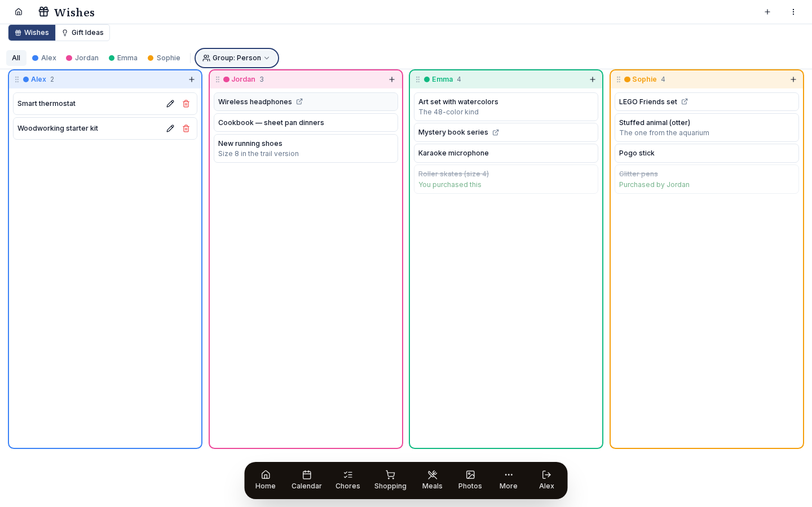

# Wish lists

Each person keeps a wish list. Others can mark a gift as taken without the wisher seeing.

{ .hero-image }

Gift givers also get a private list of their own gift ideas, which the person they are for never sees.

## Use it

### Two tabs, two purposes

The Wishes page has two tabs:

- **My Wishes**: wish lists the whole family can see. Each family member has one, and the others can secretly mark items as bought.
- **Gift Ideas**: each person's private notes of gift ideas for other family members. Only the person who wrote an idea can see it, and the person it is for never does.

Both hold the same kind of items. What differs is who can see them.

### My Wishes

#### Per-person wish lists

Each family member has their own list. The tab starts with everyone's wishes together in one list. Use the **person-filter chip-bar** at the top to show only some people, and the **Group: None / Person** switch to change the view. **Person** shows one column per family member, side by side, and you can drag the columns into a different order, which this browser remembers.

Each item has:

- **Name** (required)
- **URL**: an optional link.
- **Notes**: size, color, model number, "the one from the aquarium gift shop."
- **Added by**: who added it.
- **Claim state**: see [Claim (secret purchase)](#claim-secret-purchase).

#### Adding wishes

You add every wish in the **+ Add wish** window. Tap the **+** in the tab header, or on a person's column in the Person view, then fill in the name, URL and notes.

Anyone in the family can add to anyone's list, which helps when a parent wants to add something for a kid who has not got round to it.

#### Claim (secret purchase)

When you are shopping for someone's gift, you can **claim** an item on their wish list. This is the heart of the feature:

- Clicking an item on **someone else's** list marks it claimed.
- The claim is **hidden from the person whose list it is.** They cannot see who claimed what, or that anything is claimed at all. To them the list looks the same as before.
- Everyone else, the people who might buy gifts, sees a **"Purchased by {name}"** label, so two people do not both buy Emma the same roller skates.

Here is how it plays out:

1. Emma adds "Roller skates" to her wish list.
2. Alex sees it while shopping for her birthday and claims it. Everyone except Emma now sees "Purchased by Alex", and Alex sees "You purchased this".
3. Jordan sees "Purchased by Alex", knows the skates are taken care of, and picks something else.
4. On her birthday morning, Emma opens the skates and is surprised.

Alex, Jordan and Sophie can all see the claim, and Emma never does.

#### Cross off (got it myself)

The owner can **cross off** something they got for themselves, for example a book Emma bought that was on her list. For her, the item is then marked done.

There is one safeguard. **If someone has already secretly bought the item,** crossing it off shows *"Someone already got this for you!"* without saying who. That way Emma cannot spoil Alex's plan by crossing off skates Alex has already bought.

#### Microsoft To Do sync

Each family member's wish list can sync both ways with a Microsoft To Do list. Set it up in *Settings → Integrations → Microsoft card → Wish lists*. The old *?section=wish* address now takes you there.

- You set it up for each family member separately.
- Pick the Microsoft To Do list that goes with that person's wish list.
- The sync covers the name, the URL (stored in the notes) and the claimed state.

This helps a family member who uses Microsoft To Do on their phone: they can add to their wish list from anywhere and the items show up in Prism.

**Gift Ideas do NOT sync to MS To Do**, to keep them private. Private gift plans should never end up in a synced list the recipient might share.

### Gift Ideas

#### What it is

Your **private notebook of gift ideas for other family members**. Only you see what you write here. The person it is for never sees it, and neither does anyone else in the family.

Say you have been keeping in your head that Emma loves watercolors and would like a good art set for her birthday. A notes app or a family group chat could both let the surprise slip. Gift Ideas gives you somewhere to write it down that only you can read.

#### Layout

The Gift Ideas tab has a column for every family member except you. Alex sees columns for Jordan, Emma and Sophie, with no Alex column, and each column is Alex's private list of ideas for that person.

Jordan, on the same page, sees columns for Alex, Emma and Sophie, which hold Jordan's own private lists.

#### Per-idea data

- **Name**: what the gift is.
- **URL**: where to buy it.
- **Notes**: size, color, "she mentioned wanting this in December."
- **Price**: what it costs.
- **Purchased**: yes or no. Set it once you have bought it.
- **Sort order**.

#### Privacy enforcement

Prism keeps gift ideas private in three places:

1. **UI**: the Gift Ideas tab never shows a column for you.
2. **API**: the `/api/gift-ideas` endpoints only return rows where `created_by = currentUser.id`, so you only ever get ideas you wrote.
3. **MS To Do sync**: gift ideas are left out of every external sync and exist only in Prism.

If a child logged in with their PIN and opened Gift Ideas, they would see their own ideas for other people. They would not see what their parents are planning for them, and the same holds for everyone in the family.

#### Marking purchased

When you buy the gift, mark the idea **purchased**. It stays in your list, so you remember what you bought.

Purchased ideas stay in their column, dimmed and struck through, so you can tell at a glance what is bought and what you are still thinking about.

#### Data refresh on user switch

The Gift Ideas tab reloads its data as soon as a different person logs in. This is deliberate: without it, you could briefly see the previous person's ideas while their cached data hung around. Early versions had that problem, and v1.1 fixed it.

### Use cases

#### Birthday planning

Three months before Emma's birthday, her parents start adding ideas in Gift Ideas, where only they can see them, and Emma adds wishes to her wish list, which the family can see. The parents secretly claim items from her list and look through their own ideas. On the morning, everyone is happy.

#### Holiday season

It works the same way with more people and more gifts. Keep track of ideas and what you have bought as you shop, and note a price on each idea as you go.

#### Coordinating with extended family

Pin Grandma's gift idea ("she mentioned wanting a new tea kettle") in your Gift Ideas. If relatives are coordinating Christmas, share it with them through Prism, and never by group text, where the recipient might catch sight of it.

#### Self-purchase

Sometimes you buy yourself something that is on your own wish list. Cross it off. If someone else has already claimed it, Prism warns you so you do not end up with two. If nobody has, the item is simply struck through.

## Details

### Privacy summary

| Data | Owner sees | Other family sees | External sync |
|---|---|---|---|
| Wish list items | Yes | Yes | MS To Do (per-member opt-in) |
| Claim status (someone secretly bought it) | **No** | Yes (with claimer name) | Not synced |
| Gift Ideas (your private list) | Yes (only the creator) | **No** | **Not synced** |
| Purchased status on Gift Ideas | Yes (only the creator) | No | Not synced |

Two privacy rules must always hold:

1. The owner of a wish list never sees claims on their own list.
2. Gift Ideas never leave the account of the person who wrote them.

### Troubleshooting

#### Owner can see who claimed an item

That is a bug, so please file an issue. The owner should always see their list as if nothing were claimed, whatever has actually been claimed.

#### Gift Idea showed up for someone else

That breaks the privacy rule, so file an issue straight away. The API's filter on `created_by` should stop it, and if it does not, the bug is a serious one.

#### "Someone already got this for you" appeared on an unclaimed item

Claims are stored in the `claimed` flag. Look at the item's row in the database and check whether `claimed` was set when it should not have been. This can happen if someone claimed the item and later said they had not; the flag should clear once they unclaim it.

#### Wish list sync to MS To Do creates duplicates

This usually happens once, when a wish was created in both places before the first sync. Delete the duplicate and the deletion syncs across.

#### Cross-off undid itself when synced

Microsoft To Do marked the matching task not done, and because the newest change wins, your cross-off was reversed. Cross it off again in Prism, or fix it in Microsoft To Do.

#### Self-column showing in Gift Ideas

You should never see a column for yourself in Gift Ideas, since that would break the privacy rule. If you do, file an issue and describe how your users are set up.

#### Bought a gift through Gift Ideas but the wish list still shows unclaimed

Gift Ideas and wish-list claims are kept separately. Marking a gift idea purchased does not claim the matching wish, though that might be added later. For now, claim the wish as well.
