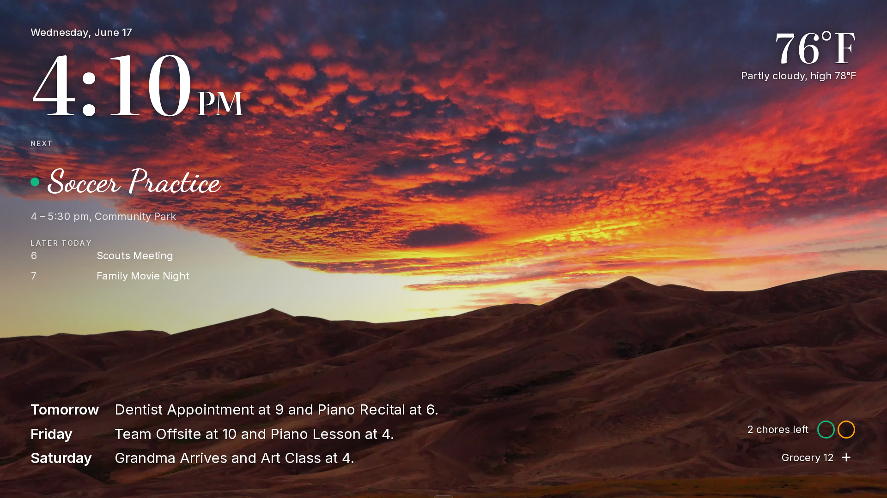
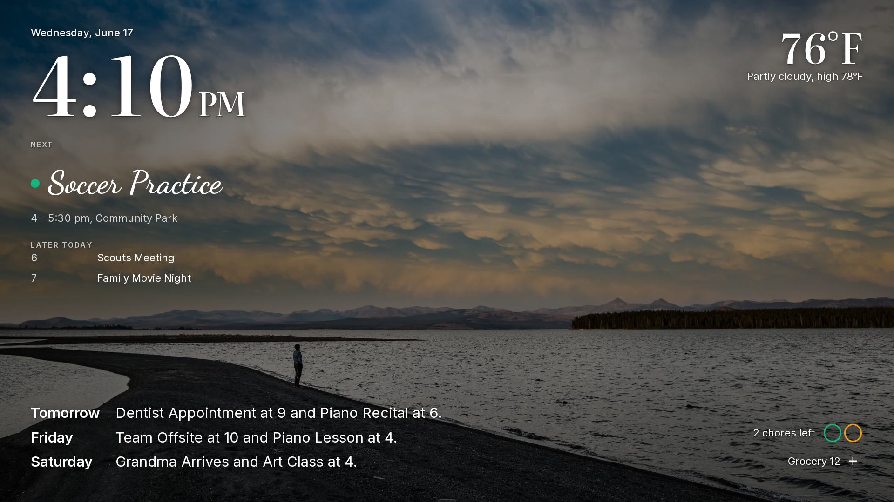
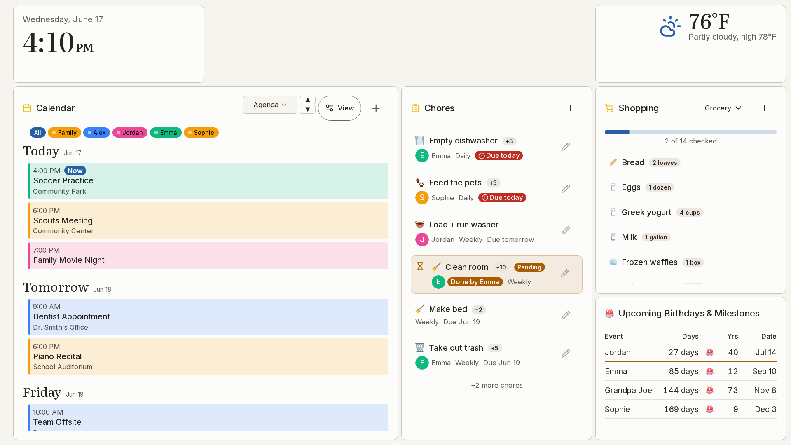

---
hide:
  - toc
---

# Screenshots

These are the screens a family sees, captured on a freshly seeded install with a made-up family (Alex, Jordan, Emma and Sophie), over the park photos Prism ships with. They are examples, and your own dashboard will look different. The feature pages show the screens for setting things up.

=== "The wall"

    A new install starts on the Simple wall, and you can lay out a dashboard of your own. Scroll sideways to see each one.

    

    <figure markdown="span">
      
      <figcaption><strong>Simple</strong>: the day as one scene over a photo, in the Photo look a new install starts with.</figcaption>
    </figure>
    <figure markdown="span">
      
      <figcaption><strong>Night</strong>: the same wall, kept dark.</figcaption>
    </figure>
    <figure markdown="span">
      
      <figcaption><strong>Your own layout</strong>: a kitchen dashboard with the week, today's chores, the shopping list and birthdays, in the Paper look's solid cards.</figcaption>
    </figure>
    <figure markdown="span">
      
      <figcaption><strong>When nobody is using it</strong>, the wall shows the photo, the clock and the weather.</figcaption>
    </figure>
    

=== "Close up"

    

    <figure markdown="span">
      
      <figcaption><strong>Calendar</strong>: each person in their own colour.</figcaption>
    </figure>
    <figure markdown="span">
      
      <figcaption><strong>Chores</strong>: who does what today, and the points it earns.</figcaption>
    </figure>
    <figure markdown="span">
      
      <figcaption><strong>Shopping</strong>: the list, grouped by category.</figcaption>
    </figure>
    

=== "On a phone"

    

    <figure markdown="span">
      
      <figcaption><strong>Home</strong>: the day at a glance.</figcaption>
    </figure>
    <figure markdown="span">
      
      <figcaption><strong>Calendar</strong>: the week as an agenda.</figcaption>
    </figure>
    <figure markdown="span">
      
      <figcaption><strong>Shopping</strong>: the list in the shop.</figcaption>
    </figure>
    

